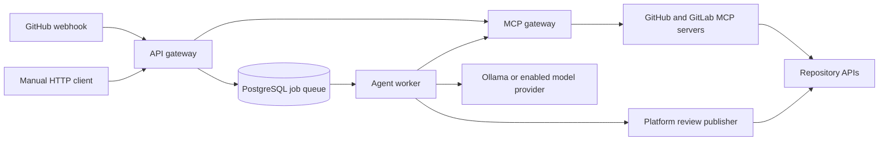
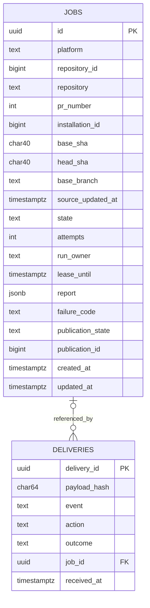

# Architecture

A component-oriented, layered Java backend. Controllers translate HTTP to DTOs, services run workflows, repositories own SQL, and platform clients own external API calls. There is no view layer. The neutral `com.prreview` namespace describes the application rather than an author or implementation milestone. One image runs three separate Java processes.

## Components and boundaries

Only the API gateway accepts normal host traffic (`localhost:18081`). Webhooks use HMAC verification, installation/repository checks and contributor/branch policy; manual requests use a separate bearer token. MCP is private and requires its own bearer token plus tool/repository/SHA scope checks. The worker has no HTTP listener. An internal network does not replace these checks.

The MCP gateway routes repository **tools**, not Claude/OpenAI/Ollama inference. It selects a configured MCP server by platform/repository; the server authenticates through a GitHub App installation token or a GitLab read token. GitHub credentials are minted by `GitHubApiClient.AppCredential`; there is no standalone broker service. Model selection belongs to `ReviewService`, based on explicit provider/model settings. Publication is a direct platform write with a separate permission path, outside read-only MCP tools.

| Package under `src/main/java/com/prreview` | Responsibility |
| --- | --- |
| `apigateway` | `ApiGatewayApplication`, controllers, request/response DTOs, admission service, webhook policy |
| `agent` | `AgentWorkerApplication`, worker orchestration, prompt batching, finding validation, model clients and optional verifier |
| `mcpgateway` | `McpGatewayApplication`, routing configuration, tool catalog, scope validation and audit |
| `mcp.client` / `mcp.server` | HTTP MCP client; downstream stdio clients and GitHub/GitLab read-only MCP servers |
| `domain.model` / `domain.port` | Snapshot, finding, job and event models; `ChangeSource` and `ReviewModel` interfaces |
| `persistence.repository` | `PostgresJobRepository`: schema setup, queue, leases, report and publication state |
| `platform.github` / `platform.gitlab` | Platform REST clients and comment reconciliation/publishers |
| `common` / `tools` | JSON, secret-file loading, concurrency control; local queue administration |

## Request-to-comment sequence

1. `ApiGatewayApplication` registers routes. `ReviewController.handle` authenticates and validates `CreateReviewRequest`; `ReviewRequestService.create` checks configuration, requests a pinned snapshot through `GatewayMcpClient`, and calls `PostgresJobRepository.enqueue`. For webhooks, `GitHubWebhookController.handle` calls `GitHubWebhookPolicy.validate` then the same repository. The HTTP acknowledgement happens **after the enqueue transaction commits**.
2. `ReviewWorker.once` recovers expired leases and calls `PostgresJobRepository.claim`. It starts a heartbeat and rechecks the pinned base/head and target branch through MCP. Repository code is read as data; it is never executed.
3. `McpGatewayService.invoke` checks authentication, catalog, repository, job context and commit scope. `StdioMcpClient` calls the platform MCP server, which uses `GitHubChangeSource` or `GitLabChangeSource` to fetch metadata, diffs and file contents.
4. `ReviewService.review` selects the configured model(s). `ReviewEngine.review` builds bounded batches from patches and supplemental context, treats repository instructions as untrusted data, requests schema-constrained JSON, and checks finding paths, added lines and exact evidence. `OllamaModelClient.generate` includes the response schema in the system prompt and calls Ollama `/api/chat`. Optional `CandidateVerifier` evaluates proposed findings. Reports include coverage and failures rather than treating incomplete analysis as clean.
5. The worker persists the report before any remote write. Under `publicationLock`, `GitHubReviewPublisher.publish` or `GitLabReviewPublisher.publish` revalidates the snapshot, finds its own marked comment, records write uncertainty, then creates or updates that comment. It records the comment ID and terminal state. Status derives the comment URL from the stored identity.

## HTTP contracts

| Method/path | Authentication | Contract |
| --- | --- | --- |
| `GET /health` | None | `200 {"status":"UP","component":"api-gateway"}` |
| `POST /api/reviews` | `Authorization: Bearer <api-token>` | Exactly `{"platform":"github","repository":"namespace/repo","number":1}`; platform is `github` or `gitlab`; `202` new job, `200` duplicate; `{jobId,state,duplicate,statusUrl}` and `Location` header |
| `GET /api/reviews/{uuid}` | Same API token | `200` with job identity, state, attempts, failureCode, publicationState, commentId, commentUrl, timestamps and nullable report; `404` unknown job |
| `POST /webhooks/github` | GitHub `X-Hub-Signature-256` over raw body, delivery and event headers | GitHub payload; `202` persisted delivery, `200` duplicate; no model work runs in this request |

Manual API errors: `400` invalid input/snapshot, `401` missing or incorrect bearer, `403` disallowed target, `413` oversized body, `503` unavailable dependency. Only open, non-draft changes on the configured target branch are accepted. The internal MCP transport is `POST /mcp` with MCP JSON-RPC and protocol/session headers, not an ordinary REST repository endpoint; use `GatewayMcpClient`.

## Database model

Source of truth: `src/main/resources/db/schema.sql`. Default schema: `review`. Initialization is serialized with a PostgreSQL advisory lock; existing queue data is retained.

`jobs` has a unique index on `(platform, repository_id, pr_number, base_sha, head_sha)` and an index on `(state, created_at)`. A delivery can reference zero or one job; multiple deliveries can reference the same snapshot job. Reusing a delivery UUID with a different payload hash is rejected. No raw webhook body or credential is stored. The `report` JSONB contains findings, coverage, model metadata and retrieval trace. GitLab MR numbers use the shared `pr_number` column; its `installation_id` is zero.

### Claims with two worker pods

**Yes: two pods sharing the same PostgreSQL database and schema cannot claim the same queued job.** `claim` takes a short transaction-level admission lock, checks global/per-repository active limits, then uses `FOR UPDATE SKIP LOCKED` and one atomic update to set `running`, increment attempts and assign `run_owner` and `lease_until`. The transaction commits before network or model work. There is no long-lived row lock during inference.

The worker renews its default 90-second lease. Report/publication/finish writes require the current owner and an unexpired lease. `recoverExpired` requeues abandoned running/publishing jobs; a new claim assigns a new owner, so stale-owner writes fail. Configure identical limits in every pod; `WORKER_MAX_JOBS` also controls local worker threads. Inference admission is process-local, not a distributed GPU semaphore. MCP review contexts are also held in gateway memory; scaling the MCP gateway itself requires session affinity or a different context-storage design.

Normal states are `queued -> running -> publishing -> succeeded`. Terminal alternatives are `partial`, `failed`, `superseded`, and `publication_uncertain`. Expired running/publishing jobs return to `queued`. An administrative retry requeues failed/uncertain jobs; it preserves any saved report and publication uncertainty.

Execution is **at least once** after lease expiry, not exactly once. Publication uses a platform/repository/change advisory lock and a stable owned-comment marker, updating an existing summary instead of blindly creating another. A remote API write and a database commit cannot form one transaction: if a response is lost, reconciliation checks the remote comment; unresolved ambiguity remains explicit. Kubernetes deployment, distributed inference limits and HA infrastructure are outside this local Compose setup.
