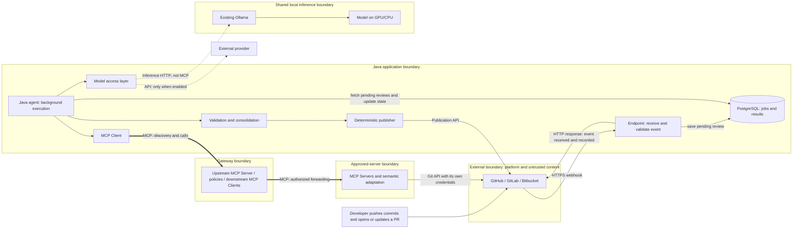
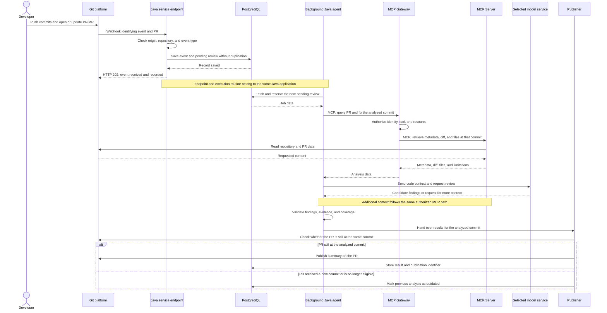

# Architecture and contracts

[Index](../README.md) · [Decisions](decisions.md) · [Security](security-and-identity.md). Initial **P** design aligned with confirmed directions.

## Where a review starts

The primary flow is automatic: **a developer pushes commits and opens or updates a PR; the Git platform sends a webhook to our Java application's endpoint; the agent analyzes the change and the application publishes the result on the PR**. Developers use their normal GitHub/GitLab/Bitbucket access; they do not need a second login to our application for each review.

The webhook endpoint belongs to the same Java service that runs the agent. It checks that the event came from the expected platform and matches the configured repository/event. This is **input validation**: checking the incoming request, not analyzing code yet.

To avoid making the webhook connection wait for the entire analysis, the proposal is:

1. Receive and validate the PR event.
2. Save a pending review record in PostgreSQL, identifying the event, repository, and PR. The exact commit is checked and fixed when preparing the analysis.
3. Return HTTP success to the platform, for example `202 Accepted`. This confirms only that the event was received and recorded; it does not mean the review is complete. This confirmation is an **acknowledgement**, abbreviated **ACK**.
4. A routine in the same Java application fetches pending reviews from the database and runs the agent. That routine is the **worker**, not a mandatory separate server. The database stores records; it does not invoke or execute the agent.
5. The agent retrieves changed code through MCP tools, queries the model, and organizes findings.
6. The application validates the findings and publishes a summary on the PR, identifying the analyzed commit.

**Harness** refers to the application coordinating the agent: retrieving context, calling tools/the model, and validating results. It is not an additional service. The diagrams below use **Java agent** to make this responsibility clear.

The planned manual trigger supports early exercises and reprocessing: provide an existing PR without relying on a webhook. It is outside the primary diagram and does not change the automatic entry point described above.

## Roles and boundaries

| Role | Responsibility |
| --- | --- |
| Java agent (host/harness) | Coordinates commit analysis: retrieves context, calls tools/the model, and organizes findings |
| Worker | Background routine in the same Java application; fetches pending reviews and invokes the agent |
| MCP Client | Maintains a server connection and consumes discovery/tools using the selected protocol profile |
| MCP Server | Exposes tools and context; does not need to contain an AI model |
| MCP Gateway | MCP Server for the agent and MCP Client for downstream servers; authorizes and routes calls |
| Model access layer | Selects provider/model; applies allowed destinations, timeout, budget, and data-transmission policy |
| Ollama | Inference service that runs a model artifact and exposes an API |
| Model | Weights, quantization, template, and capabilities executed by the service; not the harness |
| Platform adapter | Translates PR/MR identity, pagination, diffs, permissions, and operations for a specific offering |
| Webhook endpoint | Receives platform events, verifies authenticity/repository, and records a pending review |
| Publisher | Checks findings, SHA, and policy, then performs controlled writes to the platform |

OpenAI, Anthropic, and DeepSeek are model providers in this design, not automatically MCP Servers. Ollama does not replace the agent or gateway. MCP standardizes communication, not every tool's name and semantics.

Thick lines represent MCP; dotted lines represent model calls. Each boundary crossing needs its own trust evaluation. Content returned by an approved server remains untrusted data.

This diagram shows which components communicate. The next diagram shows their execution order. The **agent → database** arrow is the execution routine querying the database, not the database triggering execution. A dedicated PostgreSQL database means POC data is separate from other projects; it does not require a managed database.

## Initial process layout

**P:** one Java container contains the webhook endpoint, background routine, agent, and publisher. These are parts of one program, not four microservices. A separate Java gateway container supports learning MCP connections and authorization at that boundary. PostgreSQL stores jobs, results, and audit records. The active `divine-touch` database will not be reused implicitly.

F2 owns Ollama and PostgreSQL in this project's Compose setup, following the user's isolation request (D20). The Java review container starts a read-only GitHub MCP subprocess over stdio and calls `http://ollama:11434` separately for inference. PostgreSQL is provisioned for F4 but does not participate in manual F2 reviews. The [F2 guide](f2-local-pr-review.md) distinguishes the implemented flow from the future automatic design above.

Remote MCP Servers do not require local containers. Local HTTP servers may have their own containers. With `stdio`, the client starts and controls a subprocess and its streams: there is no HTTP URL between containers. An educational stdio server can be a child of the client/gateway; do not mount the Docker socket into the gateway to launch arbitrary containers. If an existing server requires stdio, evaluate controlled packaging of its executable with the hosting process before assuming HTTP.

Prefer Streamable HTTP for independent client/server services when both support the selected profile. Legacy SSE is not automatically equivalent. Compare the [transport specification](https://modelcontextprotocol.io/specification/2026-07-28/basic/transports) and [Java SDK](https://java.sdk.modelcontextprotocol.io/latest/) support against each implementation; parts of the consulted SDK support the newest revision only in preview.

## Local and temporary cloud profiles

| Profile | Components and dependencies |
| --- | --- |
| Local, confirmed development default | Project-owned Java/PostgreSQL/Ollama containers and required MCP Servers; the model access layer calls the project's Ollama service as described in [local inference](local-inference.md) |
| Cloud, confirmed demonstration | The same agent/gateway/publisher roles on a VPS using the selected external model API; no dependency on the personal computer, its Ollama, or desktop MCP Servers |

**P for cloud hosting:** one Docker Compose host, initially 2 vCPUs/4 GB subject to measurement; application, gateway, PostgreSQL, and optional local servers, with HTTPS on the same host. Database, gateway, and internal services use private networking. Initially, no cloud GPU, Ollama on the VPS, managed database, paid load balancer, or Kubernetes. The design and temporary lifecycle are described in [cloud-demo-and-portfolio.md](cloud-demo-and-portfolio.md).

The profile explicitly sets endpoint, model, credential reference, and allowed destinations; a local failure does not select cloud inference automatically. An HTTPS webhook calls the service directly without requiring a Git pipeline. External inference changes the model destination while tools remain governed by the application's MCP Gateway.

## Automatic review sequence

Direct server access in F1/F2 is an educational step; from F3 onward, agent tool access passes through the gateway. Publication is an application responsibility and need not be a tool exposed to the model.

## Retrieving code: API or clone

The agent must know **what changed** and read files at the **exact commit** under review. The webhook identifies the PR and event; it does not replace content retrieval.

Cloning is one retrieval method, not a requirement. **The initial POC proposal is to retrieve metadata, diffs, and files through the platform MCP Server's tools**, which query its API. This supports MCP learning and review without maintaining a complete clone for every analysis.

If the chosen server/tool needs local files, a controlled read operation can clone or fetch and select the commit. In that case, document where the copy lives and how it is discarded. Reviewing code does not require running the project, installing its dependencies, or exposing a shell to the model.

The requirement is to analyze the correct commit; **cloning is not an approved requirement or mandatory implementation**. API versus clone is a tool implementation detail; the agent still accesses tools through the MCP Gateway.

A race can occur between checking the head and publishing. Use platform preconditions when available; otherwise identify the SHA in the text, check again, and mark/suppress outdated results according to policy. Do not promise atomicity between an external API and the database.

## Proposed common contract

Names below are conceptual **P** operations, not vendor tool names or approved contracts. Adaptation can live with the gateway or server according to available capabilities; the shared semantics must keep the core independent.

| Conceptual operation | Expected input/result |
| --- | --- |
| `identify_change_request` | Platform, offering, connectionId, repositoryId, and local number → canonical identity |
| `get_change_request` | Identity → base/head SHA, branches, author, draft, state, and capabilities |
| `list_changed_files` | Identity + snapshot + cursor → page, next cursor, known totals, and completeness indication |
| `get_change_diff` | Snapshot + file/hunk + cursor → diff, sides/lines, rename information, and truncation/unavailability |
| `get_file_at_commit` | Authorized repository + SHA + validated path → bounded content, encoding/hash, and availability |
| `get_change_state` | Identity → current head/state for outdated-review checks |
| `publish_summary` | Validated result, SHA, coverage, and logical key → remote ID/URL; publisher operation, not a model tool in the MVP |
| `publish_inline_comment` | Snapshot + platform-specific diff coordinate + validated finding → comment or unsupported capability; F |

Canonical identity includes the approved instance/base URL and connection, as well as repository and number; `owner/repo#123` alone does not distinguish offerings/instances. The base URL comes from registration, never a free-form model argument.

**P for review output:** reviewId, attemptId, snapshot, provider/model/digest, prompt/schema version, findings, coverage, limitations, and status. Each finding references file, side/line or hunk, severity, explanation, evidence, and SHA. A general issue without a verifiable location becomes a limitation/summary, not an invented inline comment.

Normalize errors: unauthorized, not found, rate limit with retry timing, unavailable snapshot, binary content, truncated diff, changed schema, timeout, and transient failure. Do not convert unavailable data into valid empty content.

## Platform differences

| Target | Conditions to validate before implementing its adapter |
| --- | --- |
| GitHub.com / Enterprise Cloud | App, selected repositories, rate limits, file/diff pagination, and review positions |
| GitHub Enterprise Server | Configured host, installation version, APIs/transport, and MCP Server support; do not infer parity with github.com |
| GitLab.com / Self-Managed | Project-local MR/IID, SHA/diff refs, pagination, diff limits, tokens, and position format; version differences |
| Bitbucket Cloud | Workspace/repository, PR, pagination, authentication, and comment coordinates |
| Bitbucket Data Center | Its own instance/version, endpoints/permissions, and contracts distinct from Cloud; evaluate separately |

Webhook references: [GitLab](https://docs.gitlab.com/user/project/integrations/webhooks/), [Bitbucket Cloud](https://support.atlassian.com/bitbucket-cloud/docs/manage-webhooks/). Exact API limits and offering parity remain pending tests; no Bitbucket server has been selected.

## Catalog, connections, and reuse

A **registry** describes approved servers; it is not the running process. **Connection configuration** resolves version, URL or fixed command, transport, and credential reference. The **MCP Server** is the serving process/service. The **MCP Client** makes the calls. Catalog registration does not grant usage authorization.

Remote servers usually require a URL and authentication. Local servers may require a process, package, or container. For the POC, check required tools, SHA-specific reads, pagination, transport, and authentication for the selected server, recording the working version/configuration. Review schema/description changes before using them; do not require a corporate vendor-approval process.

The [official GitHub MCP Server](https://github.com/github/github-mcp-server) is a candidate. Documented App support over stdio is recorded in [decisions.md](decisions.md); validate the actual version and features used. Repeat necessary checks when adding another server/platform. If an essential capability is missing, evaluate a narrow adapter/complement before reimplementing every API. A small custom server remains a valid F1 exercise.

## Large PRs, coverage, and consolidation

1. Fix the snapshot and enumerate all pages. Check totals when available; repeated pages/cursor loops and missing expected data prevent a completeness claim.
2. Create a file/hunk manifest: code, tests, configuration, generated files, and binaries; renames, additions, and deletions. Exclusions follow explicit policy and remain visible.
3. Reserve tokens for instructions, tool schemas, history, and output. Split diffs/context within the remaining effective window; do not stop the file list at 20.
4. Group by feature/dependency when supported by evidence; retrieve additional context only from the authorized repository/SHA, bounded per call and job.
5. Validate/deduplicate findings and run a cross-file consolidation pass using selected evidence. Do not carry summaries across snapshots without revalidation.
6. Report enumeration completeness and analyzed, excluded, and pending items with reasons. Separate enumeration coverage from analysis coverage; report hunks/tokens when only part of a file was processed.

Isolated batches can miss relationships between components. Consolidation reduces this limitation without guaranteeing detection of every bug. Evaluate examples requiring two or more files and compare against isolated analysis. Token, duration, quota, or truncated-source limits result in partial analysis; never claim complete coverage just because all received batches were processed.

## Jobs, recovery, and concurrency

**P for states:** queued → running → validating → publishing → succeeded/partial; alternative terminal states failed/cancelled/superseded. Keep analysis and publication status separate to represent published partial results or delivery failure. F2 uses local reports; F4 adds durable state.

For the POC, the database stores event, repository/PR, analyzed commit, execution state, attempt, and result/publication. The Java routine queries pending jobs and marks the one it starts. Identifying events and summaries prevents duplication on redelivery; failures record a reason and allow reprocessing. More elaborate reservation/recovery mechanisms can be studied later without changing this basic flow.

Keep configurable job limits separate from inference/platform call limits. More jobs do not require more parallel GPU requests. Begin with a simple bounded queue and rate-limit handling; advanced fairness is an optional exercise if needed. Cancelling a job does not prove immediate cancellation of remote inference; observe remaining occupancy. Practical evaluation is described in [requirements.md](requirements.md).

Networking, volumes, health checks, and local inference maintenance are centralized in [local-inference.md](local-inference.md). VPS, budget, public evidence, and teardown are in [cloud-demo-and-portfolio.md](cloud-demo-and-portfolio.md); operational teardown is not a tool granted to the model.
