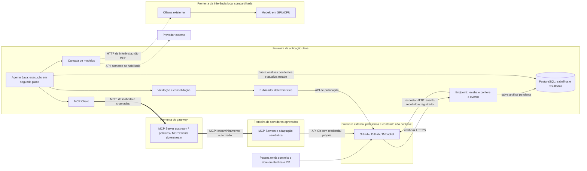
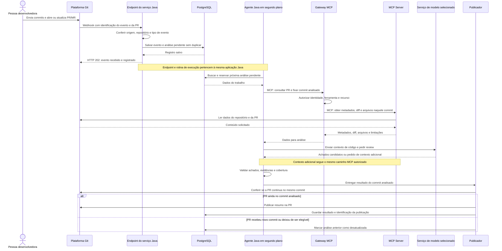

# Arquitetura e contratos

[Índice](../README.md) · [Decisões](decisions.md) · [Segurança](security-and-identity.md). Desenho inicial **P**, alinhado às direções confirmadas.

## Por onde a review começa

O fluxo principal é automático: **a pessoa envia commits e abre ou atualiza uma PR; a plataforma Git envia um webhook ao endpoint da nossa aplicação Java; o agente analisa aquela alteração e a aplicação publica o resultado na PR**. A pessoa usa o acesso normal ao GitHub/GitLab/Bitbucket; não precisa fazer um segundo login na nossa aplicação a cada review.

O endpoint de webhook faz parte do mesmo serviço Java que executa o agente. Ao receber o evento, ele verifica se veio da plataforma esperada e se corresponde ao repositório/evento configurado. Essa é a **validação da entrada**: conferir o pedido recebido, não analisar o código ainda.

Para não deixar a conexão do webhook esperando toda a análise, a proposta é:

1. Receber e validar o evento da PR.
2. Salvar no PostgreSQL um registro de análise pendente, identificando evento, repositório e PR. O commit exato será conferido e fixado ao preparar a análise.
3. Responder à plataforma com sucesso HTTP, por exemplo `202 Accepted`. Isso confirma apenas que o evento foi recebido e registrado; não significa que a review terminou. O nome técnico dessa confirmação é **acknowledgement**, abreviado **ACK**.
4. Uma rotina da mesma aplicação Java busca análises pendentes no banco e executa o agente. Essa rotina é o **worker**; não é outro servidor obrigatório. O banco guarda os registros, não chama nem executa o agente.
5. O agente obtém o código da alteração por ferramentas MCP, consulta o modelo e organiza os achados.
6. A aplicação valida os achados e publica o resumo na PR, indicando o commit analisado.

**Harness** era o termo usado para a aplicação que coordena o agente: obter contexto, chamar ferramentas/modelo e validar o resultado. Não representa um serviço adicional. Nos diagramas abaixo, usamos **agente Java** para deixar esse papel mais claro.

O disparo manual mencionado no planejamento é um caminho auxiliar para os primeiros exercícios e reprocessamento: informar uma PR já existente sem depender de webhook. Ele fica fora do diagrama principal e não muda o início automático descrito acima.

## Papéis e fronteiras

| Papel | Responsabilidade |
| --- | --- |
| Agente Java (host/harness) | Coordena a análise de um commit: obtém contexto, chama ferramentas/modelo e organiza os achados |
| Worker | Rotina em segundo plano na mesma aplicação Java; busca análises pendentes e chama o agente |
| MCP Client | Mantém conexão com um servidor e consome descoberta/ferramentas no perfil de protocolo selecionado |
| MCP Server | Expõe ferramentas e contexto; não precisa conter modelo de IA |
| MCP Gateway | Servidor MCP para o agente e cliente MCP para downstream; autoriza e roteia chamadas |
| Camada de modelos | Seleciona provedor/modelo; aplica destino permitido, timeout, orçamento e política de envio de dados |
| Ollama | Serviço de inferência; executa um artefato de modelo e oferece uma API |
| Modelo | Pesos, quantização, template e capacidades executados pelo serviço; não é o harness |
| Adaptador de plataforma | Traduz identidade de PR/MR, paginação, diffs, permissões e operações de uma oferta concreta |
| Endpoint do webhook | Recebe o evento da plataforma, verifica autenticidade/repositório e registra uma análise pendente |
| Publicador | Confere resultado, SHA e política e realiza escrita controlada na plataforma |

OpenAI, Anthropic e DeepSeek são provedores de modelos neste desenho; não são automaticamente MCP Servers. Ollama não substitui o agente ou o gateway. A comunicação MCP padroniza o protocolo, não os nomes e a semântica de todas as ferramentas.

Linhas espessas representam MCP; linhas pontilhadas representam consultas ao modelo. Toda passagem entre caixas exige avaliação própria de confiança. Conteúdo retornado por servidor aprovado continua sendo dado não confiável.

Este diagrama mostra quem conversa com quem. A sequência temporal está no diagrama seguinte. A seta **agente → banco** representa a consulta feita pela rotina de execução, e não um disparo iniciado pelo banco. “PostgreSQL próprio” significa apenas dados desta POC, separados dos bancos dos outros projetos; não exige banco gerenciado.

## Divisão inicial de processos

**P:** um container Java reúne endpoint de webhook, rotina em segundo plano, agente e publicação. São partes do mesmo programa, não quatro microserviços. Um container Java separado para gateway permite aprender a conexão MCP e a autorização nessa fronteira. PostgreSQL armazena trabalhos, resultados e registros de auditoria. O banco ativo do `divine-touch` não será reutilizado implicitamente.

O Ollama já existente permanece externo ao Compose do projeto. Servidores MCP remotos não geram container local. Servidores HTTP locais podem usar containers próprios. Para `stdio`, o cliente inicia e controla um subprocesso e seus streams: não há URL HTTP entre containers. Um servidor `stdio` didático pode ser filho do cliente/gateway; não montar o socket Docker no gateway para lançar containers arbitrários. Se um servidor existente exigir `stdio`, avaliar empacotamento controlado do executável no processo hospedeiro antes de presumir HTTP.

Preferir Streamable HTTP quando cliente e servidor forem serviços independentes e ambos suportarem o perfil escolhido. SSE legado não deve ser presumido equivalente. A especificação [de transportes](https://modelcontextprotocol.io/specification/2026-07-28/basic/transports) e a matriz do [SDK Java](https://java.sdk.modelcontextprotocol.io/latest/) precisam ser confrontadas com cada implementação; a revisão mais recente tem suporte ainda em preview em parte do SDK consultado.

## Perfis local e cloud temporário

| Perfil | Componentes e dependências |
| --- | --- |
| Local, padrão de desenvolvimento confirmado | Containers Java/banco e MCP Servers necessários; camada de modelos acessa Ollama existente conforme [inferência local](local-inference.md) |
| Cloud, demonstração confirmada | Mesmos papéis de agente/gateway/publicador em VPS com API externa selecionada; nenhum caminho depende do computador pessoal, de seu Ollama ou de servidores MCP no desktop |

**P de hospedagem cloud:** um host com Docker Compose, 2 vCPUs/4 GB iniciais sujeitos a medição; aplicação, gateway, PostgreSQL e servidores locais opcionais, com HTTPS no mesmo host. Banco, gateway e serviços internos ficam em rede privada. Sem GPU cloud, Ollama na VPS, banco gerenciado, load balancer pago ou Kubernetes inicialmente. O desenho e o ciclo temporário estão em [cloud-demo-and-portfolio.md](cloud-demo-and-portfolio.md).

O perfil define explicitamente endpoint, modelo, referência de credencial e destinos permitidos; falha local não seleciona cloud por conta própria. Um webhook HTTPS chama o serviço diretamente, sem pipeline Git obrigatório. A opção de API externa muda o destino da inferência, mantendo ferramentas sob o MCP Gateway da aplicação.

## Sequência da review automática

O acesso direto ao servidor na F1/F2 é um passo didático; a partir da F3, o acesso do agente às ferramentas passa pelo gateway. A publicação é responsabilidade da aplicação e não precisa ser uma ferramenta disponível ao modelo.

## Obtenção do código: API ou clone

O agente precisa saber **o que mudou** e ler os arquivos no **commit exato** que está revisando. O webhook identifica a PR e seus eventos; ele não substitui a obtenção desse conteúdo.

Clonar o projeto é uma forma de obter arquivos, mas não é obrigatório. **Minha proposta inicial para esta POC é obter metadados, diff e arquivos pelas ferramentas do MCP Server da plataforma**, que consulta sua API. Isso permite aprender MCP e fazer a review sem manter um clone completo para cada análise.

Se o servidor/ferramenta escolhido precisar de arquivos locais, pode haver um clone ou fetch seguido da seleção daquele commit, feito por uma operação controlada de leitura. Nesse caso, documentaremos onde fica a cópia e como é descartada. Não é necessário executar o projeto, instalar suas dependências ou oferecer shell ao modelo para revisar o código.

O requisito é analisar o commit certo; **clone ainda não foi definido como requisito ou implementação obrigatória**. API e clone são detalhes de como a ferramenta obtém os dados, mantendo o agente acessando essas ferramentas pelo MCP Gateway.

Há uma corrida possível entre consultar head e publicar. Usar precondição da plataforma quando disponível; caso contrário, fixar o SHA no texto, verificar novamente e marcar/suprimir resultado obsoleto conforme política. Não prometer atomicidade entre API externa e banco.

## Contrato comum proposto

Os nomes abaixo são conceituais **P**, não ferramentas de fornecedor nem contrato aprovado. O adaptador pode ficar junto ao gateway ou servidor, conforme as capacidades existentes; a semântica comum deve impedir acoplamento do núcleo.

| Operação conceitual | Entrada/resultado esperado |
| --- | --- |
| `identify_change_request` | Plataforma, oferta, connectionId, repositoryId e número local → identidade canônica |
| `get_change_request` | Identidade → base/head SHA, branches, autor, draft, estado e capacidades |
| `list_changed_files` | Identidade + snapshot + cursor → página, próximo cursor, totais conhecidos e sinal de completude |
| `get_change_diff` | Snapshot + arquivo/hunk + cursor → diff, lados/linhas, renomeação e indicação de truncamento/indisponibilidade |
| `get_file_at_commit` | Repositório autorizado + SHA + caminho validado → conteúdo limitado, encoding/hash e condição de disponibilidade |
| `get_change_state` | Identidade → head/estado atuais para checagem de obsolescência |
| `publish_summary` | Resultado validado, SHA, cobertura e chave lógica → ID/URL remotos; operação do publicador, não ferramenta do modelo no MVP |
| `publish_inline_comment` | Snapshot + coordenada específica de diff + achado validado → comentário ou capacidade não suportada; F |

Identidade canônica deve incluir instância/base URL aprovada e conexão, além do repositório e número; `owner/repo#123` sozinho não distingue ofertas/instâncias. A base URL vem do cadastro, nunca de um argumento livre produzido pelo modelo.

**P de resultado de review:** reviewId, attemptId, snapshot, provider/model/digest, versão do prompt/schema, achados, cobertura, limitações e status. Cada achado referencia arquivo, lado/linha ou hunk, severidade, explicação, evidência e SHA. Uma falha geral sem localização verificável vira limitação/resumo, não comentário de linha inventado.

Erros normalizados: não autorizado, não encontrado, rate limit com prazo de retry, snapshot indisponível, conteúdo binário, diff truncado, schema alterado, timeout e falha transitória. Não converter indisponibilidade em conteúdo vazio válido.

## Diferenças entre plataformas

| Alvo | Condições a validar antes do adaptador |
| --- | --- |
| GitHub.com / Enterprise Cloud | App, repositórios selecionados, rate limit, paginação de arquivos/diffs e posições de review |
| GitHub Enterprise Server | Host configurado, versão da instalação, APIs/transporte e suporte do MCP Server; não inferir paridade com github.com |
| GitLab.com / Self-Managed | MR/IID por projeto, SHA/diff refs, paginação, limites de diff, tokens e formato das posições; diferenças por versão |
| Bitbucket Cloud | Workspace/repositório, PR, paginação, auth e coordenadas de comentários específicas |
| Bitbucket Data Center | Instância e versão próprias, endpoints/permissões e contratos distintos de Cloud; avaliar separadamente |

Referências de entrada por webhook: [GitLab](https://docs.gitlab.com/user/project/integrations/webhooks/), [Bitbucket Cloud](https://support.atlassian.com/bitbucket-cloud/docs/manage-webhooks/). Limites exatos de APIs e paridade entre ofertas permanecem pendentes de testes; não há servidor Bitbucket escolhido.

## Catálogo, conexões e reaproveitamento

Um **registry** descreve servidores aprovados; não é o processo em execução. A **configuração de conexão** resolve versão, URL ou comando fixo, transporte e referência de credencial. O **MCP Server** é o processo/serviço que atende. O **MCP Client** efetua as chamadas. Registro em catálogo não concede autorização de uso.

Servidor remoto costuma exigir URL e autenticação. Local pode exigir processo, pacote ou container. Para a POC, conferir as ferramentas necessárias, leitura por SHA, paginação, transporte e auth do servidor escolhido e anotar a versão/configuração que funcionou. Revisar mudanças de schema/descrição antes de usá-las; não exigir um processo corporativo de aprovação de fornecedores.

O [GitHub MCP Server oficial](https://github.com/github/github-mcp-server) é candidato. O suporte documentado de App em `stdio` está registrado em [decisions.md](decisions.md); validar a versão e os recursos efetivamente usados. Repetir as checagens necessárias ao adicionar outro servidor/plataforma. Se faltar uma capacidade essencial, avaliar complemento/adaptador estreito antes de reimplementar todas as APIs. Um servidor próprio pequeno continua válido como exercício F1.

## PRs grandes, cobertura e consolidação

1. Fixar snapshot e enumerar todas as páginas. Verificar totais quando disponíveis; página repetida/cursor em loop e ausência de dados esperados interrompem a declaração de completude.
2. Criar manifesto de arquivos/hunks: código, testes, configuração, gerados e binários; renomeações, adições e exclusões. Exclusões seguem política explícita e ficam visíveis.
3. Reservar tokens para instruções, schemas de ferramentas, histórico e saída. Dividir diffs/contexto pelo restante da janela efetiva; não cortar a lista depois de 20 arquivos.
4. Agrupar por funcionalidade/dependência quando houver evidência; ler contexto adicional somente no repositório/SHA autorizados, com limite por chamada e trabalho.
5. Validar e deduplicar achados e realizar passagem de consolidação entre arquivos com evidências selecionadas. Não transportar resumos de um snapshot para outro sem revalidação.
6. Publicar manifesto com enumeração completa/incompleta e itens analisados, excluídos e pendentes, por motivo. Separar cobertura de enumeração da cobertura de análise; relatar hunks/tokens se só parte de um arquivo foi processada.

Lotes isolados podem perder relações entre componentes. Uma passagem de consolidação reduz essa limitação, mas não garante detectar todos os bugs. Avaliar especificamente um conjunto com bugs que dependam de dois ou mais arquivos e comparar com análise isolada. Ao atingir token, duração, quota ou fonte truncada, o estado é parcial; nunca afirmar cobertura completa por ter analisado apenas os lotes recebidos.

## Trabalhos, recuperação e concorrência

**P de estados:** queued → running → validating → publishing → succeeded/partial; finais alternativos failed/cancelled/superseded. Separar status de análise e publicação para representar resultado parcial publicado ou falha de envio. Na F2, relatório local; na F4, estado durável.

Para a POC, o banco guarda evento, repositório/PR, commit analisado, estado da execução, tentativa e resultado/publicação. A rotina Java consulta os pendentes e marca aquele que começou a executar. Identificar evento e resumo evita duplicação em reentregas; se houver falha, registrar o motivo e permitir reprocessamento. Mecanismos mais elaborados de reserva/recuperação podem ser estudados depois, sem mudar esse fluxo básico.

Separar limites configuráveis de jobs e chamadas à inferência/plataforma. Aumentar jobs não exige aumentar a GPU em paralelo. Começar com fila simples limitada e tratamento de rate limit; fairness avançado fica como exercício opcional se surgir necessidade. Cancelar job não prova cancelamento imediato de inferência remota; observar a ocupação restante. A avaliação prática está em [requirements.md](requirements.md).

Rede, volumes, health checks e manutenção da inferência local estão centralizados em [local-inference.md](local-inference.md). VPS, orçamento, evidências públicas e encerramento estão em [cloud-demo-and-portfolio.md](cloud-demo-and-portfolio.md); o encerramento operacional não é uma ferramenta concedida ao modelo.
