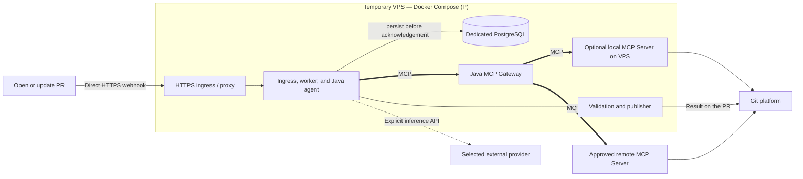

# Temporary cloud demonstration and portfolio

[Index](../README.md) · [F1–F8 plan](../PLAN.md) · [Decisions](decisions.md) · [Local inference](local-inference.md).

Planning addition dated **2026-11-12**. **C:** hands-on learning and interview portfolio; primarily local development, temporary cloud demonstration, then teardown. Commercial operation and permanent availability are not objectives. This document does not provision resources or authorize spending during planning.

## Two execution paths

| Path | Inference | Purpose and boundary |
| --- | --- | --- |
| Development and validation | Existing Ollama, starting with installed models | Confirmed default to avoid API charges during iteration; measure quality, context, tool calling, JSON, speed, and VRAM |
| Cloud demonstration | One explicitly configured external API | VPS works without personal desktop/Ollama; initially no cloud GPU or Ollama on the VPS; select one provider for the first deployment |

Java remains the harness/agent in both paths. MCP, identity, SHA, coverage, and publication policies still apply. An external API configured as the demonstration's primary model is different from automatic fallback; local-model failure does not authorize external transmission.

A Git pipeline is unnecessary to start a review: the webhook calls the service directly. A future build/deployment pipeline is an independent choice. Desktop independence requires necessary MCP Servers to be remote or runnable on the VPS with valid credentials there; do not depend on a desktop tunnel/process.

## Proposed hosting

**P:** one Docker Compose machine, initially **2 vCPUs and 4 GB RAM**. Run application, gateway, PostgreSQL, and a local MCP Server if needed, with measured memory/concurrency limits. Do not run the models on this machine. Observe JVM RSS/heap, CPU, database, queue, disk, and latency; reduce load or revisit size before claiming capacity.

Avoid a managed database, paid load balancer, and Kubernetes in this POC. A same-host HTTPS proxy is proposed TLS termination, not a paid load balancer. Plan minimal DNS/certificate, firewall, and backup/export needs; gateway, database, and internal servers do not need public ports. Build images before the paid window when possible and validate `amd64`/`arm64` components if selecting ARM.

Confirmed research preference: low-effort available free resources/credits first, then a usage-proportional VPS; one machine. If obtaining free resources takes more effort than the demonstration, consider a short paid VPS within the cost target.

| Candidate, not yet selected | Reference/check on 2026-11-12 | Pending before provisioning |
| --- | --- | --- |
| Oracle Always Free | [Official documentation](https://docs.oracle.com/en-us/iaas/Content/FreeTier/freetier_topic-Always_Free_Resources.htm) describes eligible resources and possible capacity shortages; Ampere requires ARM | Region/availability, current limits, ARM images/components, and eligible account; do not confuse trial credits with permanent free access to arbitrary resources |
| DigitalOcean | User-provided **US$0.03571/h** for 2 vCPUs/4 GiB also appears in the [official catalog](https://www.digitalocean.com/pricing/droplets); 48 h is approximately **US$1.71 compute** | SKU/region, disk, IP, traffic, taxes, and final current price; do not apply this figure to a different configuration such as v5 |
| DigitalOcean credit | User supplied a **US$5** reference for eligible accounts; the [official page](https://www.digitalocean.com/pricing) illustrates US$5 credit valid for 90 days | Account eligibility/balance was not queried; do not deduct credits before confirming their award/expiration |
| Hetzner | [Official catalog](https://www.hetzner.com/cloud/) consulted as an alternative; no price/region/SKU pinned in this update | Final price, currency/taxes, availability, architecture, and billing/deletion terms at deployment |

[DigitalOcean billing documentation](https://docs.digitalocean.com/products/droplets/details/pricing/) describes per-second billing with a minimum and continued CPU Droplet charges while powered off. The hourly reference supports estimation, not mandatory hour-long billing blocks. Deleting the VM ends compute billing; check additional resources separately.

## Economical API: research and future selection

The following are user-provided candidates, without a quality ranking or winning provider. Prices are dated official-source snapshots, in **US$ per million uncached input / output tokens**, not cost per review. Revalidate availability, endpoint, exact identifier, tier, region, tool calling, schema support, and data policy before comparison and again before deployment.

| Candidate | Reference consulted on 2026-11-12 | Condition to evaluate |
| --- | --- | --- |
| GPT-6 Luna | [Official model](https://developers.openai.com/api/docs/models/gpt-6-luna): **0.10 / 0.50** | API/reasoning mode affects function-calling compatibility; test the chosen Java integration and structured output |
| Claude Haiku 5.5 | [Official prices](https://platform.claude.com/docs/en/about-claude/pricing): **0.05 / 0.25** for prompts up to 100,000 tokens; **0.25 / 1.25** above | Each call uses its applicable prompt band; validate cache, tools, schema, and quality |
| GPT-OSS via Groq | [Official catalog](https://console.groq.com/docs/models): `openai/gpt-oss-20b` **0.075 / 0.30**; 120b **0.15 / 0.60** | Hosted offering has its own limits/semantics; do not assume operational equivalence with the local model |
| DeepSeek Flash | [Official prices](https://api-docs.deepseek.com/quick_start/pricing/): **0.15 / 0.60** off-peak and **0.30 / 1.20** peak, uncached input | Pin alias/version, billing window, and capabilities; generic JSON does not prove JSON Schema conformance |
| Mistral Small | [Official prices](https://docs.mistral.ai/inference/pricing): published Small 4 variant **0.15 / 0.60** | Select the variant identifier and validate capabilities; do not silently replace an evaluated model |

Free **Gemini** and **Groq** plans can enter screening if their quotas/data policies suit the POC. Consult [Gemini pricing/tier](https://ai.google.dev/gemini-api/docs/pricing) and [Groq limits](https://console.groq.com/docs/rate-limits); free access guarantees neither sufficient volume nor appropriate private-code handling. Do not use private data by default in public evaluation.

**P for economical selection:** reuse four labeled local-evaluation cases: known bug, correct change, cross-file bug, and prompt injection. Screen candidates through documentation and execute only one or two finalists within budget before selecting **one** initial provider. Record valid findings, false positives, tools/arguments, output, coverage, time, and cost. Do not implement every provider to deliver the first demonstration.

Measure all attempts, including failed/partial reviews, retries, JSON repairs, context resent each round, instructions, schemas, tool results, and billed reasoning tokens. Separate uncached input, cache reads/writes, output, and additional fees. When reasoning is already included in billable output, do not count it twice. Compare total experiment spending and cost per accepted review; token prices alone do not decide.

Endpoint/model and credential reference remain configurable with approved destinations. Do not reuse Codex login as a Java credential or assume **ChatGPT Plus** supplies API credits; the separation is documented in [local-inference.md](local-inference.md).

## Budget and paid window

**F6 selection, executed on 2026-11-14:** OpenAI Responses with `gpt-6-luna`/medium matched the four public synthetic reference cases in six calls. Estimated API usage cost was USD 0.001092175; conservative retained reservations were USD 0.01639775 against the user's approved USD 0.10 trial cap. This selects the first external provider; it neither changes the local single-model default nor authorizes VPS creation, another paid trial, private transmission or an account top-up. Native model tools and cloud capacity were not validated by that run. [Settings, failures, usage and evidence](f6-model-providers.md).

**P, target to validate:** **US$5–10 total** for demonstration infrastructure and inference. Choose the concrete cap before spending; the range is neither an available balance nor purchase authorization. Record gross cost, actually applied credits, and net cash spending separately.

Estimated total = compute for the period + storage/IP/traffic/backups/other extras + all model calls + margin for taxes/exchange rates and delayed metering. Check minimum top-up/prepayment too: upfront cash outlay may exceed test consumption. The US$1.71/48 h example covers compute only.

Develop and validate locally first; create the VPS only when the flow is ready. Before the paid window, define PRs/attempts, per-review/campaign limits, tokens, calls, retries, and duration; reserve part of the cap for infrastructure and unexpected costs. Billing alerts do not guarantee automatic cutoff or instant measurements. The application must prevent new calls after its limit, without implicit external fallback.

## Evidence and public-release preparation

Produce gradually using publishable fixtures and demonstration repositories:

- README, diagrams, decisions, local/cloud execution instructions, and reproducible versions/configuration without secrets.
- PR/result examples with SHA, findings, coverage, limitations, and webhook/job/authorization/MCP/model/publication correlation.
- Evaluations with expected results, false positives, prompt injection attempts, and denied access, plus latency, memory, and actual-cost measurements with their conditions.
- A short recording showing PR creation/update, progress, and the published result; hide credentials, sensitive dashboards, and private data.
- A record of execution window, resources, artifact export, and teardown so the result remains understandable after endpoint removal.

Before making the repository public, review files **and history**, example licenses/provenance, PR links, and data permissions. Absolute paths, other projects' names, and internal inventory details are diagnostic notes; prepare a sanitized public version with parameterized paths and only publishable information. Preserve useful requirements/evidence without exposing private information. The original `prompt.md`, if retained in a publication source/history, is also subject to this review; this document does not remove or publish it.

Future configuration examples use placeholders/secret references. Do not version App keys, tokens, real `.env` files, cloud credentials, prompts with private code, or invoices containing personal data. Keep proposed measurements separate from executed results. An online installation is not required after the POC.

## Proposed teardown

1. Stop accepting new jobs, finish/cancel attempts, and disable/remove the demonstration webhook to avoid retries against a discarded endpoint.
2. Export examples, metrics, results, costs, and recording; verify sanitized files can be read outside the VPS before deleting data.
3. Inventory VM, volumes, snapshots, backups, reserved IPs, any load balancers, and other campaign resources. During the future teardown task, delete only resources identified as belonging to the POC.
4. Delete the VM and unneeded billable extras; check orphan resources, DNS, and schedules. Stopping a container, running Compose down, or powering off the VM may leave charges active.
5. Revoke/remove temporary credentials and demonstration access without revoking shared identities from other projects; record what remains and why.
6. Check the dashboard/invoice and API usage after metering updates. Record deletion time, final cost, and any residual charges. Completion needs teardown evidence, not just a powered-off-server screen.

No infrastructure creation, modification, or deletion was performed by this planning update. The initial learning exercise is F1 without AI.
