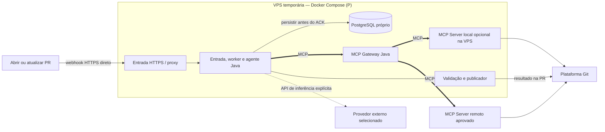

# Demonstração cloud temporária e portfólio

[Índice](../README.md) · [Plano F1–F8](../PLAN.md) · [Decisões](decisions.md) · [Inferência local](local-inference.md).

Complemento de planejamento em **12/11/2026**. **C:** aprendizado prático e portfólio para entrevistas; desenvolvimento principalmente local, demonstração cloud temporária e remoção posterior. Não há objetivo de serviço comercial ou disponibilidade permanente. Esta documentação não provisiona recursos nem autoriza gasto nesta tarefa.

## Dois caminhos de execução

| Caminho | Inferência | Finalidade e limite |
| --- | --- | --- |
| Desenvolvimento e validação | Ollama existente, começando pelos modelos instalados | Padrão confirmado para evitar cobrança de API durante as iterações; qualidade, contexto, tool calling, JSON, velocidade e VRAM são medidos |
| Demonstração cloud | Uma API externa explicitamente configurada | VPS funciona sem desktop/Ollama pessoal; sem GPU cloud nem Ollama na VPS inicialmente; selecionar um provedor para o primeiro deploy |

O Java permanece harness/agente nos dois caminhos. As mesmas políticas de MCP, identidade, SHA, cobertura e publicação continuam aplicáveis. Inferência externa configurada como principal da demonstração é diferente de fallback automático; a falha do modelo local não autoriza envio externo.

Não é necessário pipeline Git para iniciar a review: o webhook chama o serviço diretamente. Um pipeline de build/deploy futuro é uma escolha independente. Para demonstrar independência do computador pessoal, servidores MCP necessários devem ser remotos ou executáveis na própria VPS, com credenciais válidas ali; não depender de túnel ou processo hospedado no desktop.

## Hospedagem proposta

**P:** uma máquina com Docker Compose, inicialmente **2 vCPUs e 4 GB de RAM**. Executar aplicação, gateway, PostgreSQL e, se necessário, servidor MCP local, com limites de memória e concorrência medidos. Não executar os modelos nessa máquina. Medir RSS/heap das JVMs, CPU, banco, fila, disco e latência; reduzir carga ou rever tamanho antes de alegar capacidade.

Evitar banco gerenciado, load balancer pago e Kubernetes nesta POC. Um proxy HTTPS no mesmo host é proposta de terminação TLS, não um load balancer pago. Planejar DNS/certificado, firewall e backup/exportação mínimos; gateway, banco e servidores internos não precisam de portas públicas. Construir imagens antes da janela paga quando possível e validar `amd64`/`arm64` dos componentes se escolher ARM.

Ordem de pesquisa confirmada como preferência: recurso gratuito/crédito disponível sem esforço excessivo; depois VPS com cobrança proporcional ao tempo; uma única máquina. Se obter gratuidade consumir mais esforço que a demonstração, avaliar a VPS paga curta dentro da meta de custo.

| Candidato, ainda não escolhido | Referência e verificação em 12/11/2026 | Pendência antes de provisionar |
| --- | --- | --- |
| Oracle Always Free | [Documentação oficial](https://docs.oracle.com/en-us/iaas/Content/FreeTier/freetier_topic-Always_Free_Resources.htm) descreve recursos elegíveis e possível falta de capacidade; opção Ampere requer ARM | Disponibilidade/região, limites vigentes, imagens/componentes ARM e conta elegível; não confundir trial com gratuidade permanente de qualquer recurso |
| DigitalOcean | Referência fornecida pelo usuário de **US$ 0,03571/h** para 2 vCPUs/4 GiB também aparece no [catálogo oficial](https://www.digitalocean.com/pricing/droplets); 48 h correspondem a aproximadamente **US$ 1,71 de compute** | SKU/região, disco, IP, tráfego, impostos e preço final no momento; não aplicar esse valor a outra configuração, como v5 |
| Crédito DigitalOcean | Usuário trouxe referência de **US$ 5** para elegíveis; a [página oficial](https://www.digitalocean.com/pricing) exemplifica crédito de US$ 5 válido por 90 dias | Elegibilidade e saldo desta conta não foram consultados; não descontar crédito antes de confirmar concessão/validade |
| Hetzner | [Catálogo oficial](https://www.hetzner.com/cloud/) consultado como alternativa; não foi fixado preço/região/SKU nesta atualização | Preço final, moeda/impostos, disponibilidade, arquitetura e termos de cobrança/exclusão no deploy |

A [documentação DigitalOcean de cobrança](https://docs.digitalocean.com/products/droplets/details/pricing/) informa granularidade por segundo com mínimo e cobrança enquanto a CPU Droplet estiver apenas desligada. A referência horária serve ao cálculo, não exige cobrança em blocos de uma hora. Excluir a VM encerra compute; recursos adicionais devem ser verificados separadamente.

## API econômica: pesquisa e escolha futura

Os nomes abaixo são candidatos fornecidos pelo usuário, sem ranking de qualidade ou provedor vencedor. Preços são snapshots de fontes oficiais, em **US$ por milhão de tokens de entrada sem cache / saída**, não custo por review. Revalidar disponibilidade, endpoint, identificador exato, tier, região, tool calling, schema e política de dados antes da comparação e novamente antes do deploy.

| Candidato | Referência consultada em 12/11/2026 | Condição a avaliar |
| --- | --- | --- |
| GPT-6 Luna | [Modelo oficial](https://developers.openai.com/api/docs/models/gpt-6-luna): **0,10 / 0,50** | API/modo de raciocínio alteram compatibilidade de function calling; testar a integração Java escolhida e saída estruturada |
| Claude Haiku 5.5 | [Preços oficiais](https://platform.claude.com/docs/en/about-claude/pricing): **0,05 / 0,25** até 100 mil tokens de prompt; **0,25 / 1,25** acima disso | Cada chamada é tarifada pela faixa aplicável; validar cache, ferramentas, schema e qualidade |
| GPT-OSS via Groq | [Catálogo oficial](https://console.groq.com/docs/models): `openai/gpt-oss-20b` **0,075 / 0,30**; 120b **0,15 / 0,60** | Oferta hospedada tem limites/semântica próprios; não presumir equivalência operacional ao modelo local |
| DeepSeek Flash | [Preços oficiais](https://api-docs.deepseek.com/quick_start/pricing/): **0,15 / 0,60** fora do pico e **0,30 / 1,20** no pico, entrada sem cache | Fixar alias/versão, janela de cobrança e capacidades; JSON genérico não comprova aderência a JSON Schema |
| Mistral Small | [Preços oficiais](https://docs.mistral.ai/inference/pricing): variante publicada Small 4 **0,15 / 0,60** | Selecionar identificador da variante e validar capacidades; não substituir silenciosamente um modelo já avaliado |

Planos gratuitos de **Gemini** e **Groq** podem entrar na triagem se cotas e políticas de dados servirem à POC. Consultar [preços/tier Gemini](https://ai.google.dev/gemini-api/docs/pricing) e [limites Groq](https://console.groq.com/docs/rate-limits); gratuidade não garante volume suficiente ou tratamento adequado de código privado. Não usar dados privados na triagem pública por padrão.

**P de seleção econômica:** reutilizar quatro cenários rotulados do benchmark local — bug conhecido, alteração correta, bug entre arquivos e prompt injection. Fazer triagem documental de todos os candidatos e executar apenas um ou dois finalistas, conforme orçamento, antes de escolher **um** provedor inicial. Registrar achados válidos, falsos positivos, ferramentas/argumentos, saída, cobertura, tempo e custo. Não implementar todos os provedores para realizar a primeira demonstração.

Medir custo de todas as tentativas, inclusive reviews falhas/parciais, retries, reparos de JSON, contexto reenviado em cada rodada, instruções, schemas, resultados de ferramentas e tokens de raciocínio cobrados. Separar entrada sem cache, leitura/gravação de cache, saída e taxas adicionais. Quando raciocínio já integrar o total faturável de saída, não somá-lo novamente. Comparar gasto total do ensaio e custo por review aceita; preço por token sozinho não decide.

Endpoint/modelo e referência de credencial continuam configuráveis, com destinos aprovados. Não reutilizar login do Codex como credencial do Java nem presumir créditos de API por possuir **ChatGPT Plus**; a separação está documentada em [local-inference.md](local-inference.md).

## Orçamento e janela paga

**P, meta a validar:** **US$ 5–10 no total**, infraestrutura e inferência da demonstração. Escolher o teto concreto antes de gastar; não interpretar a faixa como saldo disponível ou autorização de contratação. Registrar custo bruto, créditos efetivamente aplicados e desembolso líquido separadamente.

Estimativa total = compute pelo período + armazenamento/IP/tráfego/backups/outros adicionais + todas as chamadas de modelo + margem para tributos/câmbio e atraso de medição. Verificar também mínimo de recarga/pré-pagamento do provedor: desembolso antecipado pode exceder o consumo do teste. O exemplo de US$ 1,71/48 h cobre apenas compute.

Desenvolver e validar localmente primeiro; subir VPS somente com fluxo pronto. Antes da janela paga, definir número de PRs/tentativas, limite por review e por campanha, tokens, chamadas, retries e duração; reservar parte do teto para infraestrutura e imprevistos. Alertas de faturamento não garantem bloqueio automático ou medição instantânea. A aplicação precisa impedir novas chamadas ao esgotar seu limite, sem fallback externo implícito.

## Evidências e preparação pública

Produzir gradualmente, usando fixtures e repositórios de demonstração publicáveis:

- README, diagramas e decisões, instruções de execução local/cloud e versões/configuração reproduzíveis sem valores secretos.
- Exemplos de PR e resultado com SHA, achados, cobertura, limitações e correlação entre webhook, job, autorização, MCP, modelo e publicação.
- Avaliações com gabarito, falsos positivos, tentativas de prompt injection e acessos negados, além de medições de latência, memória e custo real com condições do ensaio.
- Gravação curta mostrando abrir/atualizar PR, andamento e resultado publicado; ocultar credenciais, painéis sensíveis e dados privados.
- Registro da janela de execução, recursos usados, exportação de artefatos e encerramento, permitindo entender o resultado após a remoção do endpoint.

Antes de tornar o repositório público, revisar arquivos **e histórico**, licenças/proveniência de exemplos, links de PR e permissões dos dados. Os caminhos absolutos, nomes de projetos alheios e detalhes internos do inventário atual são notas de diagnóstico; preparar uma versão pública sanitizada, com caminhos parametrizados e apenas informações adequadas à publicação. Preservar requisitos e evidências técnicas úteis sem expor informação privada. `prompt.md` também entra nessa revisão; não foi removido nem publicado nesta tarefa.

Exemplos de configuração futura usam placeholders/referências de segredo. Não versionar chaves de App, tokens, `.env` real, credenciais de cloud, prompts com código privado ou faturas com dados pessoais. Medições propostas devem permanecer separadas de resultados efetivamente executados. Não há obrigação de manter instalação online depois da POC.

## Encerramento proposto

1. Encerrar entrada de novos trabalhos, concluir/cancelar tentativas e desabilitar/remover webhook da demonstração para evitar retries contra endpoint descartado.
2. Exportar exemplos, métricas, resultados, custo e gravação; verificar leitura dos arquivos sanitizados fora da VPS antes de excluir dados.
3. Inventariar VM, volumes, snapshots, backups, IPs reservados, balanceadores eventualmente criados e demais recursos da campanha. Na tarefa futura de encerramento, excluir somente os recursos identificados como pertencentes à POC.
4. Excluir a VM e os adicionais cobrados sem necessidade de retenção; verificar recursos órfãos, DNS e agendamentos. Apenas parar container, executar Compose down ou desligar a VM pode deixar cobrança ativa.
5. Revogar/remover credenciais temporárias e acesso da demonstração, sem revogar identidades compartilhadas de outros projetos; registrar o que foi mantido e por quê.
6. Conferir painel/fatura e consumo da API após a atualização da medição. Registrar horário de exclusão, custo final e cobrança residual, se houver. O término da demonstração exige evidência de encerramento, não só tela de servidor desligado.

Nenhuma criação, alteração ou exclusão de infraestrutura foi executada nesta atualização. O próximo exercício continua sendo a F1 sem IA.
