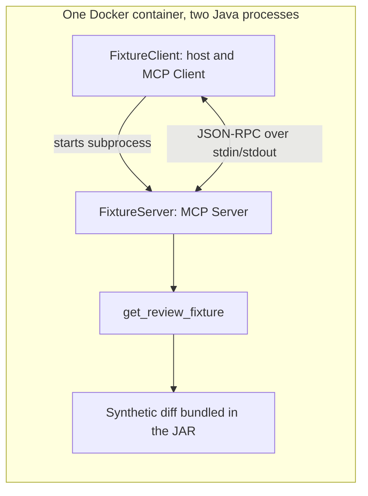

# F1 — first Java MCP call, without AI

[Index](../README.md) · [Plan](../PLAN.md) · [Intended final architecture](architecture.md).

**Implemented and verified on 2026-11-12.** This exercise shows a Java client starting a local MCP Server, discovering a tool, and receiving a synthetic diff. It does not perform an AI review: no Ollama, model API, GitHub, credentials, or database. The gateway is introduced in F3.

## What runs



The **stdio** transport connects one process's output to the other's input. There is no HTTP port or network connection between client and server. The client starts the server and terminates the subprocess when closing the connection. This differs from the independent HTTP containers used later to study the gateway.

## Run with Docker

Prerequisite: Docker Desktop running Linux containers. Java and Maven on Windows are optional: this build uses them inside Docker. The first build needs networking to download images and dependencies; running the example works without networking.

From the project root:

```powershell
docker build --progress plain -t mcp-api-gateway:f1 .
docker run --rm --network none mcp-api-gateway:f1
```

The build compiles and runs tests; a failing test prevents creation of the final image. Docker Compose and other services are unnecessary for this exercise. The container receives no volumes, publishes no ports, and runs as a non-root user.

The example prints:

1. `initialize`: server name and negotiated protocol version.
2. `tools/list`: tool name, description, and schema.
3. `tools/call`: valid request and returned diff, with `isError: false`.
4. Unknown scenario, missing argument, and wrong-type requests, with `isError: true`.
5. Connection and server-process shutdown.

The console shows the methods and payloads used by the client, not a complete capture of JSON-RPC envelopes. Message IDs, serialization, and initialization lifecycle are handled by the SDK.

To demonstrate an unavailable server:

```powershell
docker run --rm --network none mcp-api-gateway:f1 --server-unavailable
$LASTEXITCODE
```

This mode deliberately tries to start a nonexistent server class. Initialization has a five-second timeout; communication fails with a readable message and **exit code 1**, expected for this scenario. It does not change or stop another project's server.

If Java 21 and Maven are already installed, the local alternative is:

```powershell
mvn --batch-mode --no-transfer-progress verify
java -Dorg.slf4j.simpleLogger.defaultLogLevel=off -cp "target/mcp-api-gateway.jar;target/lib/*" dev.cleisommais.mcp.f1.FixtureClient
```

The Windows classpath separator is `;`; Linux/macOS use `:`. This delivery was verified in Docker, not with a host Java installation.

## Read the files in this order

| File | What to learn |
| --- | --- |
| [FixtureClient.java](../src/main/java/dev/cleisommais/mcp/f1/FixtureClient.java) | The host creates the MCP Client, starts the server, negotiates the protocol, lists tools, makes calls, and closes the connection |
| [FixtureServer.java](../src/main/java/dev/cleisommais/mcp/f1/FixtureServer.java) | The server registers a tool and uses stdio; it contains no AI model |
| [ReviewFixtureTool.java](../src/main/java/dev/cleisommais/mcp/f1/ReviewFixtureTool.java) | Argument schema, known-scenario rule, and text/structured output; the `record` represents fixture data |
| [off-by-one.diff](../src/main/resources/fixtures/off-by-one.diff) | Synthetic data crossing MCP; replacing `<` with `<=` introduces an out-of-bounds array access, but no diff code is executed |
| [McpRoundTripTest.java](../src/test/java/dev/cleisommais/mcp/f1/McpRoundTripTest.java) | Real tests between two JVMs without protocol mocks |
| [pom.xml](../pom.xml) and [Dockerfile](../Dockerfile) | Dependencies/build and exercise packaging |

On the server, **stdout is reserved for the protocol**; diagnostics belong on stderr. Ordinary text on server stdout can corrupt communication. Client stdout can display the demonstration because it is the process interacting with the person at the terminal.

## Educational tool contract

`get_review_fixture` accepts only `scenario`, a nonempty string. It accepts neither additional properties nor a file path. The only implemented scenario is `off-by-one`.

```json
{"name":"get_review_fixture","arguments":{"scenario":"off-by-one"}}
```

The result contains the diff in `content` and `scenario`, `repository`, `commit`, `file`, and `diff` in `structuredContent`. The repository and SHA are fictitious and stable; they do not represent a GitHub query.

The SDK validates the **schema**: required field, type, minimum length, and additional properties. The tool handler validates the **business rule**: whether the scenario exists. Both errors are returned as tool failures, preserving the connection for a subsequent valid call. This distinction is part of the exercise.

## Choices pinned for this phase

- Java 21; Maven 3.9.11 in the build container.
- Official Java MCP SDK **2.1.0**, a stable release; do not automatically adopt the milestone shown by `latest` documentation.
- Stdio transport and synchronous API; protocol **2025-11-25** negotiated and checked in tests.
- The `mcp` SDK with its default JSON integration; no Spring Boot or Spring AI for this first call. They remain options for later phases.
- Images `maven:3.9.11-eclipse-temurin-21` and `eclipse-temurin:21-jre-jammy`. Java image tags may receive patches: application/SDK versions are pinned, but the build is not advertised as byte-for-byte reproducible.

References consulted: [SDK 2.1.0 release](https://github.com/modelcontextprotocol/java-sdk/releases/tag/v2.1.0), [quickstart](https://java.sdk.modelcontextprotocol.io/latest/quickstart/), [client](https://java.sdk.modelcontextprotocol.io/latest/client/), and [server](https://java.sdk.modelcontextprotocol.io/latest/server/). The `latest` documentation can evolve; the build and tests verify the combination pinned in this phase's POM.

## Verified result

`docker build --progress plain --tag mcp-api-gateway:f1 .` completed with **7 tests, zero failures, and zero errors**:

- Discovery, schema, protocol, and valid-call content.
- Five invalid inputs: missing field, wrong type, empty string, unknown scenario, and an additional property containing a path; a valid call still works after each failure.
- Unavailable-server initialization failure with a bounded timeout.

The final image also ran with `--network none`: normal demonstration exit code 0 and unavailable-server exit code 1. The client terminated the subprocess in both cases.

To consolidate the learning, follow the same call through the client, schema, and handler. The next increment is F2: retrieve PR context and query a model. This exercise does not yet create jobs, webhooks, a gateway, or AI analysis.
