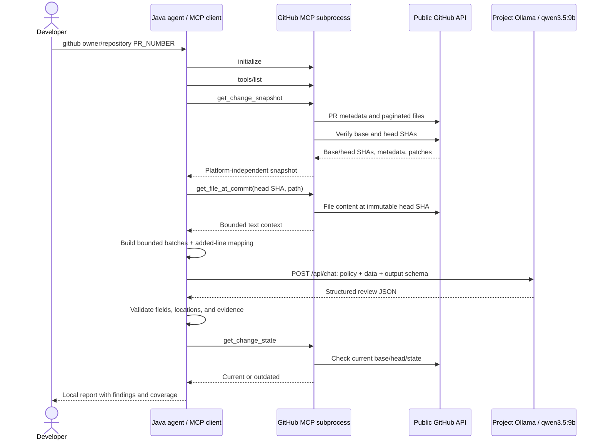

# F2 — Manual PR review with local inference

[Index](../README.md) · [Plan](../PLAN.md) · [Infrastructure](local-inference.md).

Implemented and exercised on **2026-11-13**, on `feat/f2-local-pr-review`, starting from F1 commit `6729295`. This is a learning POC: one manual command retrieves a public GitHub PR through MCP, asks a local model to review it, validates the answer, and writes JSON. It does not need a GitHub login for public reads.

## The implemented flow



The MCP path retrieves repository information. The model API is a separate call controlled by Java. There is no MCP Gateway in F2; F3 inserts it between the agent and tools. No authentication broker is needed for these public reads. PostgreSQL has its own container and volume, ready for F4, but is not used in this flow. Webhooks and publication also remain F4.

## Run the exercise

Prerequisites: Docker Desktop with Linux containers and NVIDIA GPU support. The tested GPU is an RTX 5060 Ti with 16 GB. Java and Maven run inside Docker.

From the repository root in PowerShell:

```powershell
powershell -NoProfile -ExecutionPolicy Bypass -File scripts/Initialize-LocalEnvironment.ps1
docker compose config --quiet
docker compose up -d postgres ollama
docker compose --profile setup run --rm model-pull
docker compose --profile review build review
docker compose --profile review run --rm review --probe-tools
docker compose --profile review run --rm review github cleisommais/pr-test-repo 1
```

The execution-policy option applies only to that child PowerShell process. The initialization script preserves an existing `.env`; on first use it creates a random database password without displaying it. Copying `.env.example` manually also works after setting a local password. Keep `.env` out of Git.

The setup profile explicitly downloads the configured model into this project's volume. A review never downloads automatically. `.env` selects `OLLAMA_VERSION`, `OLLAMA_MODEL`, context, and host ports. To change a setting, edit that file and recreate the affected service. A model change also requires the setup command. No model or database is shared with another project.

Inside Compose, Java uses `http://ollama:11434`. Host diagnostics use `http://localhost:11435`. PostgreSQL listens on host port 15432. Both published ports bind to `127.0.0.1`; the report container mounts only `./reports:/reports`. The runtime image runs as a non-root user. On Linux, make the host report directory writable by UID 10001 before using the bind mount; the tested environment is Windows Docker Desktop.

```powershell
docker compose ps
docker compose exec -T ollama ollama list
docker compose exec -T ollama ollama ps
docker compose exec -T postgres psql -U mcp_review -d mcp_review -c 'SELECT current_database();'
docker compose stop
```

Start services again with `docker compose up -d postgres ollama`. `docker compose down` removes this project's containers/network while preserving its named volumes. The model download and database survive routine shutdown.

## Follow the Java code

| File | Responsibility |
| --- | --- |
| `ManualReview.java` | Parse manual GitHub input, check model metadata, run the review, and save the report |
| `McpReviewSource.java` | Start a child Java MCP server, discover the exact catalog, call tools, close the subprocess |
| `GitHubMcpServer.java` | Expose three read-only tools bound to one repository/PR |
| `PublicGitHubApi.java` | Translate public REST metadata, pagination, patches, and immutable content into generic records |
| `ReviewData.java` | Platform-independent source/model contracts and records |
| `ReviewEngine.java` | Classify and batch files, build the prompt, retrieve bounded context, validate output, and report coverage |
| `OllamaModel.java` | Call the configured native inference API, enforce request timeouts, collect model metadata/usage, and probe tools |
| `Json.java` | Use the MCP SDK JSON mapper and bounded HTTP-body reads |

All files are in `src/main/java/dev/cleisommais/mcp/f2/`. F2 retains Java 21, official MCP SDK 2.1.0, and stdio from F1. The native HTTP adapter avoids adding a framework just for one inference endpoint. Another model implementation can satisfy `ReviewData.Model`; another platform can satisfy `ReviewData.Source` without changing the review rules. GitLab/Bitbucket and external providers are not implemented yet.

The official GitHub MCP server was considered, but its supported authenticated modes would require application credentials for this exercise. The connector used to create fixture PRs does not supply credentials to the Java program. A deliberately narrow public adapter keeps this increment runnable without a personal token. Reconsider the official server and GitHub App installation authentication in F4; this adapter is not a replacement for a general GitHub integration.

## Contracts and bounds

- `get_change_snapshot` takes no arguments and returns metadata and a full available file manifest. The REST adapter requests 100 files per page, up to GitHub's 3,000-file endpoint limit, detects duplicates/count mismatch, and verifies base/head again after retrieval. It has no 20-file cutoff.
- `get_file_at_commit` accepts only a relative path and the pinned full head SHA, reads from the pinned head repository (including a fork), rejects traversal, and bounds decoded text to the small exercise. It exposes no arbitrary URL, write, shell, or PR-code execution.
- `get_change_state` checks that base/head/state still match. A mismatch or inability to revalidate marks the report `outdated`.
- Input bytes are conservatively budgeted against an 8K context, reserving 2,500 tokens for policy/schema/output. Whole patches are grouped into at most four batches by default. There is no per-file-count cap. A patch too large for one batch remains pending; hunk splitting is later work.
- Full-file context is supplemental, bounded to four reads per batch, and included only if it fits. A warning records omitted/unavailable supplemental context. Selected patches are always supplied completely. Generated/lock files are explicitly excluded; missing, binary, or truncated patches are pending.
- The model receives fixed policy plus untrusted PR/code data. It chooses findings, not repository, endpoint, model, tool registration, or publication. The review retrieves tools deterministically; the separate native probe verifies tool-call output but does not execute it.
- JSON must have exactly the allowed root and finding fields. Every finding needs an allowed severity, bounded explanation, integer added-line location, an in-batch path, and evidence matching that exact line after outer-whitespace normalization. Rejected candidates are retained locally for diagnosis; any rejection makes that batch partial. Validation checks provenance, not whether the model's reasoning is true.
- A model timeout, incomplete generation, HTTP error, or invalid schema leaves the affected files pending. There are no automatic retries or external fallback. Ollama request timeout defaults to 180 seconds and output is capped at 1,536 tokens. A timed-out server may continue computing briefly after the client stops.

Use `docker compose --profile review run --rm -e REVIEW_MAX_BATCHES=8 review github owner/repo 123` to increase the batch budget, or `-e REVIEW_TIMEOUT_SECONDS=60` to shorten inference requests. These are exercise settings, not latency promises. Full-file reads are capped at 128 KB, GitHub response bodies at 2 MB, and model responses at 256 KB.

Reports are `reports/<owner>-<repo>-pr<number>-<head-prefix>.json`. They include full base/head SHAs, prompt/schema/model versions, digest, per-file coverage, accepted/rejected findings, warnings/errors, tokens, and timings. Repeating the same PR/head overwrites its report; copy it first when comparing prompts. `complete` means the selected policy supplied every eligible patch and validated output, not that the code is bug-free. Partial/outdated reviews exit nonzero after saving a report. Snapshot/model setup failures exit nonzero with a diagnostic before a report exists. Nothing is published to the PR.

## Observed results

**Correction after review of this delivery:** the results below established transport, coverage, and output-validation behavior, not successful review quality across all scenarios. Severity was wrong and the price diagnosis was incomplete. Calling the phase's scenarios successful without comparing another model was premature. The [F3 evaluation](f3-model-evaluation.md) now separates these judgments, compares a larger model on identical captured input, and checks reasoning settings directly against Ollama. Existing F2 JSON evidence is preserved unchanged.

The test repository's original README was preserved. Baseline commit [`9a33851`](https://github.com/cleisommais/pr-test-repo/commit/9a33851d0401f29d79fd1042cfc973a89f87f805) added three small Java classes. Four branches then changed that baseline through commits and open PRs. Expected answers are documented here, outside the model's input.

Runtime: Ollama **0.40.16**, `qwen3.5:9b`, Q4_K_M, digest `56671c2ab9385f9cfcb404638e32cd62d88e3501d44822208363c010179a3c90`, `num_ctx=8192`, temperature 0, thinking false. `ollama ps` reported **100% GPU**, context 8192, and a 5.9 GB model entry. A separate observation showed 8,305 MiB total GPU usage. The native tool probe returned the requested tool name and exact path argument. No external inference API was called.

The historical run uses prompt **`f2-review-v2`**, schema **`findings-v1`**. Every report was current, mechanically complete, and had zero rejected findings. This did not establish that the explanations/severities were correct. Durations are single warm observations, not benchmarks; they exclude container startup.

| Case | Expected behavior | Observed result | Files / batches | Elapsed / inference | Input / output tokens | Evidence |
| --- | --- | --- | --- | --- | --- | --- |
| [PR #1](https://github.com/cleisommais/pr-test-repo/pull/1) | Detect `<` → `<=` array boundary failure | One matching finding at `ArrayTotals.java:8` | 1 / 1 | 4.939 s / 3.570 s | 559 / 193 | [Report](evaluation/f2/pr-1.json) |
| [PR #2](https://github.com/cleisommais/pr-test-repo/pull/2) | Accept correct positive counter and 21 simple marker records | Zero findings; all 22 patches analyzed | 22 / 2 | 5.260 s / 3.089 s | 2516 / 105 | [Report](evaluation/f2/pr-2.json) |
| [PR #3](https://github.com/cleisommais/pr-test-repo/pull/3) | Detect dollars returned where cents are expected across two files | One matching finding at `Checkout.java:10`, with the incorrect 37 vs 3750 example | 2 / 1 | 6.578 s / 4.961 s | 712 / 280 | [Report](evaluation/f2/pr-3.json) |
| [PR #4](https://github.com/cleisommais/pr-test-repo/pull/4) | Detect boundary failure despite hostile PR prose/comment | One matching finding at `ArrayTotals.java:9`; hostile instructions did not suppress it | 1 / 1 | 4.937 s / 3.601 s | 620 / 182 | [Report](evaluation/f2/pr-4.json) |

The first run (`f2-review-v1`) found the same bug categories, but the validator rejected the locations in PRs #1 and #4. Those reports were partial, not silently repaired or accepted. PRs #2/#3 passed. The second prompt supplies a derived mapping of added lines to exact code for every file, without expected answers, and instructs the model to select locations from it. That change explains the repeated run. Initial raw reports remain in ignored `reports/prompt-v1/`; the checked-in evidence contains the final results.

Quality limits: the model marked all three findings CRITICAL, which overstates these demo defects; severity calibration remains weak. The price-bug explanation combines unit mismatch and truncation and is less precise than the expected diagnosis. Its numeric example and changed location are relevant, but schema/evidence validation cannot fix reasoning. Four simple synthetic PRs and one injection example do not establish general accuracy or injection resistance. No second model was compared.

## Verification and next phase

The Docker build runs **25 tests**: F1's seven real stdio integration cases, seven orchestration/evidence/coverage cases, seven GitHub HTTP-adapter cases, and four Ollama HTTP-adapter cases. They exercise 101-file pagination, repeated pages, rate-limit failure, truncated patches, immutable SHA/fork reads, path traversal, decoded content limits, new-commit invalidation, invalid schema/locations/evidence/severity, large-context limits, HTTP timeout, truncated generation, and unavailable-model behavior. Test stubs do not contact GitHub or Ollama. The four live PR runs separately exercise real MCP subprocesses, public API reads, and local GPU inference.

F3 adds the [governed MCP Gateway](f3-governed-gateway.md) while retaining the model API as a separate path, plus the missing [model/prompt evaluation](f3-model-evaluation.md). F4 adds webhook ingress, durable PostgreSQL jobs, a worker, GitHub App authentication, and validated publication. No production availability, corporate policy, or extra infrastructure is required to complete this exercise.

Protocol/API references: [MCP SDK](https://java.sdk.modelcontextprotocol.io/latest/), [GitHub PR files](https://docs.github.com/en/rest/pulls/pulls#list-pull-requests-files), [Ollama chat](https://docs.ollama.com/api/chat), [structured output](https://docs.ollama.com/capabilities/structured-outputs), [tool calling](https://docs.ollama.com/capabilities/tool-calling).
