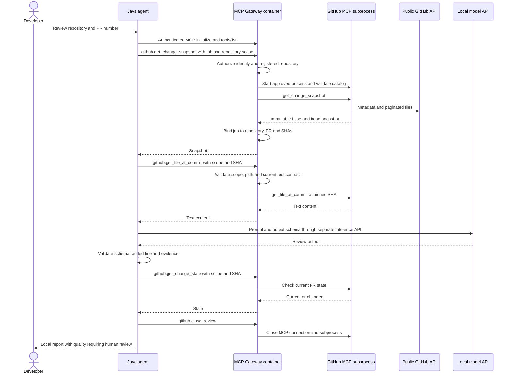

# F3 — Governed MCP Gateway

[Index](../README.md) · [Plan](../PLAN.md) · [Model evaluation](f3-model-evaluation.md).

Implemented on `codex/f3-governed-gateway`, from F2 commit `3dc9c23`. This increment adds the gateway in a separate Java container and corrects the earlier conflation of mechanical output validation with review quality. This is still a local learning POC; it introduces no IdP, cloud service, webhook, or database queue.

**Current checkout:** F4 now adds the [edge/queue/worker](f4-webhook-jobs.md). Its base Compose file keeps the gateway internal. To reproduce F3 host-port debugging, explicitly combine `compose.yaml` with `compose.debug.yaml`; normal container-to-gateway calls are unchanged. The historical F3 results below remain evidence for that increment.

## Implemented flow



The gateway governs tools. Model selection and generation options remain in the Java inference adapter. The worker's gateway credential is not a model API credential and is not forwarded downstream. Public GitHub reads need no GitHub token or authentication broker. GitHub App authentication and publication are F4 work.

## Run

```powershell
powershell -NoProfile -ExecutionPolicy Bypass -File scripts/Initialize-LocalEnvironment.ps1
docker compose --profile review build gateway review
docker compose up -d postgres ollama
docker compose --profile setup run --rm model-pull
docker compose --profile review up -d gateway
docker compose --profile review run --rm review github cleisommais/pr-test-repo 1
docker compose logs gateway
```

The updated initializer preserves existing values and fills only missing/empty local credentials, including `GATEWAY_TOKEN`. It does not print secrets. The credential stays in ignored `.env`; `.env.example` contains blank placeholders. Its HTTP use is a single-worker local lab identity, not an implementation of OAuth or an authorization server.

The agent and gateway share the application image, `mcp-api-gateway:f3`, but run as separate containers/processes. The gateway listens internally on 8080 and publishes only `127.0.0.1:18080`; PostgreSQL/Ollama keep their existing separate project volumes. `/health` returns a basic readiness response. `/mcp` requires the worker credential for every HTTP method and rejects browser Origin requests. Never put the credential in a tool argument or prompt.

Compose sets `MCP_SOURCE=gateway` and `MCP_GATEWAY_URL=http://gateway:8080`. Gateway mode is also the Java command's default, and an unavailable gateway fails visibly. `MCP_SOURCE=direct` is an explicit historical F2 exercise mode, outside the governed path; there is no automatic direct-access fallback. The model API still uses `http://ollama:11434`.

Generation options are explicit: `OLLAMA_MODEL`, `OLLAMA_THINK`, `REVIEW_OUTPUT_TOKENS`, `OLLAMA_CONTEXT_LENGTH`, and `REVIEW_PROMPT_PROFILE`. Thinking accepts `true`/`false` or supported named levels `low`/`medium`/`high`; `/api/show` metadata is recorded and available named-level restrictions are checked. `original` reproduces F2's prompt; `calibrated` adds severity definitions and arithmetic/runtime guidance. Increasing the output budget reserves more of the context window and may create more batches. `REVIEW_MAX_BATCHES` and request timeouts remain bounded. See the [evaluation](f3-model-evaluation.md) before interpreting a model choice as a quality guarantee.

The selected default is `gpt-oss:20b` with `medium` reasoning, 8K context, and 4,096 output tokens. Its observed GPU fit and four-case human assessment are in the evaluation. When upgrading another checkout from F2, update those model settings in `.env` deliberately: the initializer preserves an existing model value rather than silently replacing it. This workspace was updated as part of the authorized comparison.

## Registration, routing, and authorization

`config/gateway.json` is a read-only mount loaded at startup. It specifies the lab principal, maximum open reviews, and approved server registration, version, transport, protocol, and repositories. Only the bundled public-GitHub stdio adapter is supported in this increment. The implementation does not pretend to be a general dynamic server marketplace.

The registered server is `public-github`, with version `0.2.0` and protocol `2025-11-25`. Registration maps `cleisommais/pr-test-repo` to that server. Tool calls cannot provide a URL, executable, credential, new server, or registration update. Another demonstration repository can be added deliberately to the read-only administrative file, followed by gateway recreation. Ambiguous duplicate routes and unapproved executable/transport/version combinations fail startup validation.

Upstream tool names are namespaced; the gateway maps them to the approved downstream operation:

| Upstream tool | Arguments | Behavior |
| --- | --- | --- |
| `github.get_change_snapshot` | `jobId`, `repository`, `number` | Authorize repository, create a bounded MCP subprocess if needed, retrieve/pin snapshot; repeated calls return the same snapshot |
| `github.get_file_at_commit` | Scope above plus `sha`, `path` | Require matching job owner, registered server, repository, PR, pinned head SHA, and safe relative path before forwarding |
| `github.get_change_state` | Scope plus `sha` | Validate scope, then check current platform state |
| `github.close_review` | Scope plus `sha` | Release the job's downstream client/subprocess; remains possible even if the downstream schema has drifted |

The first snapshot request is the bootstrap step: no SHA is known yet. The gateway verifies the returned repository/PR/platform and full base/head SHAs, then binds them to the job. Every subsequent non-snapshot call requires the pinned head SHA. Repository/PR switching under the same job is denied, even when the other repository is registered.

The gateway independently pins the exact downstream tool names, input schemas, descriptions, server version, and protocol. Discovery is checked at connection time and the catalog is rechecked before each forwarded operation. An unexpected contract is rejected instead of being silently exposed to the agent. The stdio child receives only the SDK's platform environment allowlist; inherited gateway/database credentials are removed. No Docker socket or model volume is mounted into the agent/gateway.

Only one worker identity is configured. Other identities are denied by policy; the HTTP credential maps to the configured principal outside model control. Independent users, token issuance, delegated OAuth, and multitenancy are later exercises. A simple synchronized gateway serializes operations; this does not demonstrate concurrent production capacity.

## Reports and audit

Reports include `retrieval.mode=gateway`, a job ID, server alias, protocol, prompt/model/options metadata, coverage, and findings. Match that job ID to the gateway's JSON console audit. Events record principal, tool, registered server, repository, SHA, decision/reason, and duration without code or bearer tokens. Authentication failures have an anonymous transport event. SDK protocol/schema rejection can happen before a scoped handler; those errors are not presented as successful forwarded calls.

`status=complete` describes coverage and mechanical validation. **`qualityStatus=requires-human-review`** explicitly separates model reasoning quality. Matching a line of evidence cannot validate arithmetic, severity, an inferred requirement, or a missing finding. Evaluation-only frozen reports also identify their capture/replay status; offline replay cannot verify the PR's current state.

Jobs are in memory and capped at eight by the initial administrative configuration. Normal client closure releases the subprocess. A crashed client can leave a lab job until gateway restart; restart discards all gateway jobs. This is not the durable PostgreSQL worker queue planned for F4. A failed review does not restart Ollama, pull a model, or select an external provider.

## Verification

The build runs 42 tests. F3 exercises allowed routing; unknown identity/repository/tool/destination; wrong PR/SHA/path; changed catalog; wrong downstream resource; unavailable server; bounded open jobs; connection cleanup; authentication and Origin rejection over real HTTP; and real MCP discovery of the GitHub stdio subprocess without contacting GitHub. Comparison tests check exact-input hashes, frozen context, and absence of live-state claims in offline replay. Inference tests include boolean/named reasoning controls and reserved output context. Earlier F1/F2 tests remain included.

The separate containers also ran the real public PR scenarios through HTTP → gateway → stdio → GitHub. Their model quality failures and improvements are preserved in the [evaluation](f3-model-evaluation.md), rather than being counted as gateway test failures or hidden by valid JSON. The next application increment is F4: webhook ingress, durable PostgreSQL jobs, worker recovery, installation credentials, and controlled publication.

API references: [SDK Streamable HTTP server](https://java.sdk.modelcontextprotocol.io/latest/server/), [SDK client](https://java.sdk.modelcontextprotocol.io/latest/client/), [embedded Tomcat API](https://tomcat.apache.org/tomcat-10.1-doc/api/org/apache/catalina/startup/Tomcat.html). Tested dependencies are pinned in the POM; the negotiated MCP revision remains 2025-11-25.
