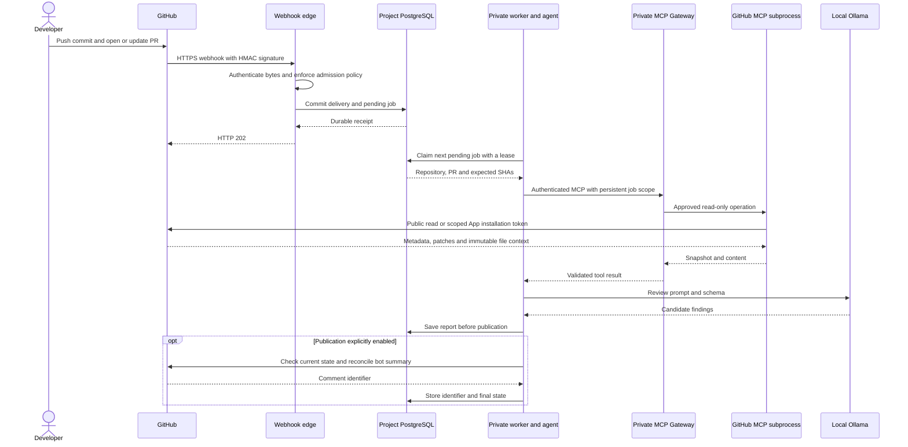

# F4 — Signed webhooks, durable jobs, and private GitHub access

[Index](../README.md) · [App installation steps](f4-github-app-setup.md) · [Architecture](architecture.md).

Implemented on `codex/f4-webhook-jobs-private-repos`, starting from F3 commit `5752a40`. The local edge/queue/worker flow and deterministic authentication/publication tests are verified. **Live GitHub App installation authentication, private review through that installation, bot publication, and real GitHub webhook delivery remain pending the user's setup.** A local signed fixture is not evidence of a live GitHub delivery. This guide preserves that distinction.

## Flow and security boundaries



The edge, worker, and MCP Gateway use the same Java image but are **separate containers**, not one exposed agent service. The edge commits a job; it does not call an agent HTTP endpoint. The worker polls PostgreSQL and has no public endpoint. The gateway has no host port by default. `compose.debug.yaml` can restore an explicit loopback-only debugging port.

Three identities serve different purposes:

| Boundary | Implemented control |
| --- | --- |
| GitHub → edge | HMAC-SHA256 over the original bytes, checked before parsing/queueing; expected installation and allowed repository ID/name |
| Worker → MCP Gateway | Existing generated worker credential plus per-call job/repository/PR/SHA checks |
| MCP adapter/publisher → GitHub | App private key signs a short JWT; repository-scoped short-lived installation tokens; read permissions for the adapter and PR-write permissions for the publisher |

Private networking limits reachability; it does not grant identity or repository permission. Gateway checks remain in place. GitHub Actions are not required: the GitHub platform sends a native webhook. A future Actions-triggered administrative endpoint would need its own authenticated flow, such as scoped Actions OIDC, rather than reusing a PR payload as proof of identity.

IP allowlisting is optional defense at a future public edge. It is not a replacement for HMAC and must account for trusted proxies/tunnels. This implementation does not trust caller-supplied forwarding headers as identity or add a production IAM platform.

## Admission policy

`config/automation.json` contains the two demonstration repository IDs/names and target branch `main`. Accepted actions are `opened`, `synchronize`, `reopened`, and `ready_for_review`; closed PRs, drafts, and other target branches are skipped. A signed ping is acknowledged without a job. Other irrelevant events/actions are recorded as ignored.

By default, author association must be OWNER, MEMBER, or COLLABORATOR, and fork PRs are skipped. This prevents an unknown contributor from opening a public fork PR simply to consume inference. It is an adjustable POC policy, not a promise that repository code is trusted or safe to execute. PR code is never executed by the review agent. The signature authenticates event origin, not the contents' instructions.

Requests are bounded to 1 MB. Wrong signature/installation/repository is rejected; invalid event data returns an error; database failure returns 503 instead of receipt success. There is no public manual-review or retry endpoint. The edge can start before installation setup, but PR events cannot be accepted with an unconfigured installation ID.

## Queue and recovery

The application creates its own `review` schema in this project's existing PostgreSQL database. No other project's database or volume is touched. JDBC 42.7.14 is pinned; no additional broker or migration framework is introduced.

- `deliveries` stores delivery UUID, body hash, event/action, outcome, and associated job ID. It does not store raw webhook bodies. Reusing a delivery ID with a different body is rejected.
- `jobs` is unique by repository ID, PR number, base SHA, and head SHA. A duplicate body or a new delivery ID for the same snapshot reuses the logical job without re-running a completed review.
- The edge commits before HTTP 202. A redelivery receives the saved receipt; no inference runs on the HTTP request thread.
- The worker claims with PostgreSQL `FOR UPDATE SKIP LOCKED`, assigns an owner, and records an attempt. A 90-second lease is renewed every 15 seconds while a model call is in progress. Expired running/publishing work is requeued without dropping the saved report or publication uncertainty.
- Newer queued events supersede older queued work for the same PR. The worker still checks the actual snapshot and eligibility: delayed events can refer to an outdated head, a changed target branch, a closed PR, or a draft. Such work cannot be published as current.
- The report is saved before publication. Recovery can reuse it after a fresh MCP state check. Job UUIDs are passed to the gateway and recorded in reports/audit, so the database and MCP flow can be correlated.

Job states include `queued`, `running`, `publishing`, `analyzed` (publication disabled), `succeeded`, `partial`, `superseded`, `failed`, and `publication_uncertain`. Failures record a stage/class or GitHub HTTP code without dumping code, tokens, or the private key. A lost lease prevents the old worker from completing a job as its owner.

F4 runs one worker process by default. The claim/lease mechanism prevents two claimants from owning the same active job; it is not a production concurrency/capacity claim. Queue durability does not imply exactly-once model execution. A crash can require another inference attempt, while publication uses reconciliation to avoid deliberate duplicates.

## Private repository behavior

MCP tools and input schemas do not change merely because a repository is private. Tool discovery can succeed while the underlying GitHub read is denied. The running adapter needs its own GitHub credential; the developer connector's private access cannot be copied into it.

The registry preserves an anonymous public connection and adds `private-github-app` for `cleisommais/pr-test-repo-private`. The gateway chooses this administrative registration from repository scope. The model does not choose a credential, destination, or authentication mode. The bundled server advertises the unified `github-review` identity; its tool contract remains version 0.2.0 with protocol 2025-11-25.

The gateway passes only App ID, installation ID, authentication mode, and the mounted PEM path to its controlled stdio process. The parent environment is cleared first, so worker/gateway/database credentials are not inherited. Tokens are minted inside the adapter and refreshed before expiry. A 401 GET can refresh once; writes are not blindly retried. Revocation/denial/rate-limit responses fail visibly. Installation token requests are restricted to the job repository. Private-fork supplemental context outside that scope is denied rather than broadening the credential.

The real unauthenticated MCP path to private PR #1 returned GitHub HTTP 404, as expected for masked private access. Deterministic HTTP tests verify denied reads without a credential and successful reads with a scoped credential, plus absence of that token in the snapshot. **Positive live installation access has not been verified yet.** Follow the [installation guide](f4-github-app-setup.md), then run all four private scenarios.

## Publication

`PUBLISH_REVIEWS=false` is the default. Enabling it permits the worker to publish an application-controlled summary after snapshot and evidence validation. The model has no write tool. The comment identifies the full analyzed head SHA, coverage, and need for human review; model text is escaped and mentions neutralized.

One marker identifies the bot's summary for a repository/PR. The publisher searches only comments authored by the authenticated App bot; another user's copied marker cannot impersonate it. Existing summaries are updated. A per-PR PostgreSQL publication lock serializes writes, separately from the admission lock so an external API call does not hold up webhook persistence.

The database marks uncertainty immediately before the external write. If GitHub commits a comment but the response is lost, the publisher searches for its bot-owned marker instead of creating a second comment. Restarted work preserves this uncertainty. If reconciliation cannot establish whether a comment exists, the job stops as `publication_uncertain`; a local retry reconciles again and does not blindly POST. The returned remote identifier is persisted on success.

PR state is checked before and after publication. GitHub's issue-comment API does not atomically bind a write to a PR head: a commit can still race between the state check and write. The post-write check marks such a summary outdated. This is an explicit POC limitation, not an exactly-once/current-head guarantee. Inline comments, merge, and automatic approval remain outside the phase.

## Private fixtures and verified checks

The original private README was preserved and a synthetic Java baseline plus dependency-free checks were added. Baseline commit: `c383d84f95f731d057ccf082537fedad233088bb`.

| PR | Scenario | Fixture check |
| --- | --- | --- |
| [#1](https://github.com/cleisommais/pr-test-repo-private/pull/1) | Array boundary defect | Expected array-bounds failure |
| [#2](https://github.com/cleisommais/pr-test-repo-private/pull/2) | Correct positive counter, 21 marker records, and a new positive-counter check; 23 changed files | Baseline and positive-counter checks pass |
| [#3](https://github.com/cleisommais/pr-test-repo-private/pull/3) | Cross-file dollars/cents defect | Expected calculation assertion failure |
| [#4](https://github.com/cleisommais/pr-test-repo-private/pull/4) | Boundary defect plus hostile review instructions | Expected array-bounds failure |

The newly authored synthetic fixture sources were compiled/tested in a network-disabled container, outside the review agent. This validates seeded examples; it does not add execution of PR code to the agent. Private source/report contents remain outside committed public evidence.

Verification: **58 non-database tests pass** in the Docker build; the three real PostgreSQL tests are deliberately skipped there and **pass separately** in the Compose checks service. The 61 unique checks cover earlier phases plus signatures/admission, raw HTTP acknowledgment behavior, authenticated private reads, scoped JWT/token refresh with PKCS#1/PKCS#8 keys, wrong-scope access, publication ambiguity, spoofed markers, stale-state publication, durable deduplication, concurrent claims, restart/lease recovery, and persisted publication IDs.

An additional local end-to-end fixture returned HTTP 202, then HTTP 200 with the same job ID on redelivery. The real PostgreSQL database recorded one delivery/job and one attempt. The worker used the actual MCP Gateway and local `gpt-oss:20b`, produced a current report, and finished as `analyzed` with no publication. This used a synthetic installation ID and a locally signed public-PR payload; **it was not an actual GitHub delivery or private-App validation**. [Sanitized evidence](evaluation/f4/).

## Run and inspect

Use the [step-by-step App guide](f4-github-app-setup.md) for live setup. Local checks:

```powershell
docker compose --profile automation build gateway
docker compose --profile testing build checks
docker compose --profile testing run --rm checks
```

The database tests create and remove only uniquely named `f4_it_...` schemas. The local end-to-end fixture's persisted data is in `f4_demo`, separate from normal `review` jobs.

Administrative access is a local CLI, not an exposed HTTP API:

```powershell
docker compose --profile automation run --rm --no-deps --entrypoint java worker -cp '/app/mcp-api-gateway.jar:/app/lib/*' dev.cleisommais.mcp.f4.QueueAdmin show JOB_UUID
docker compose --profile automation run --rm --no-deps --entrypoint java worker -cp '/app/mcp-api-gateway.jar:/app/lib/*' dev.cleisommais.mcp.f4.QueueAdmin retry JOB_UUID
```

Replace `JOB_UUID` with the real job ID. Retry applies to failed/uncertain jobs and preserves any saved report/uncertainty; it is not a request to reanalyze a successful result with a new model. New model/peer-review experiments remain explicit manual/F6 work.

## Optional second model

F6 now includes a primary-plus-verifier experiment, **disabled by default and not implemented by this phase**. The primary proposes findings; a second configured model checks them against the same fixed context. Disagreements stay visible instead of blindly merging both lists. It needs explicit extra-call/time/cost controls and comparison against the single-model cases. Sequential calls fit the single-GPU lab more naturally than loading two large models together. Two models can share the same error or add false positives, so this is an experiment rather than an automatic quality claim.

References: [GitHub signatures](https://docs.github.com/en/webhooks/using-webhooks/validating-webhook-deliveries), [installation authentication](https://docs.github.com/en/apps/creating-github-apps/authenticating-with-a-github-app/authenticating-as-a-github-app-installation), [App JWTs](https://docs.github.com/en/apps/creating-github-apps/authenticating-with-a-github-app/generating-a-json-web-token-jwt-for-a-github-app), [issue/PR comments](https://docs.github.com/en/rest/issues/comments), [pgJDBC](https://jdbc.postgresql.org/download/).
