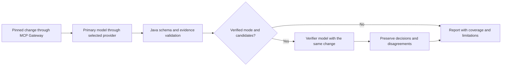

# F6: model providers and optional candidate verification

[Index](../README.md) · [Plan](../PLAN.md) · [F3 model investigation](f3-model-evaluation.md).

F5 is committed as `0043bcf`, including the manual-versus-agent comparison for GitLab. F6 continues on `codex/f6-model-provider-comparison`. F7 was started briefly, then reverted at the user's request; no F7 concurrency changes are included here.

## Implemented behavior

Single-model local review remains the default: `MODEL_PROVIDER=ollama`, `REVIEW_MODE=single`, `OLLAMA_MODEL=gpt-oss:20b`, medium reasoning. Both the manual CLI and GitHub worker use the same provider/session layer. The GitLab CLI uses it through the same review contract.

`REVIEW_MODE=verified` adds a sequential verifier. The primary proposes findings; Java validates their schema and pinned added-line evidence before passing valid candidates to the verifier. The verifier gets the same immutable change and candidate list, and returns one `supported`, `disputed`, or `uncertain` decision for each candidate. It cannot add findings or invoke tools.

Supported candidates remain in the main findings list. Disputed/uncertain candidates remain visible under `verification.batches[].primaryFindings` and the decision records, and the review becomes partial. Verifier failure preserves the primary output, marks verification incomplete, and cannot produce a clean approval. Summaries explicitly identify verifier status. The verifier's reason is model output, not proof that either model is correct.

An empty primary result skips verification. **This mode cannot discover a bug missed by the primary**, and it is not an independent second review. Malformed primary evidence is rejected by the existing engine, without asking the verifier to repair it. If candidates plus the original context do not fit, verification is visibly incomplete; context is not silently truncated to fit.



Model APIs are called directly by the Java session, separately from MCP repository tools. Neither model chooses a credential or provider, and local failure never selects an external provider.

## Local configuration and reproduction

The installed comparison candidate is `qwen3:14b` with thinking disabled. This is a candidate to measure, not a claimed upgrade: earlier F3 runs exposed weaknesses in that family. Models run sequentially because the lab has one GPU and Ollama keeps at most one model loaded.

```powershell
docker compose --profile review build gateway
docker compose --profile evaluation run --rm f6-evaluate single
docker compose --profile evaluation run --rm f6-evaluate verified
```

The evaluation uses the same four frozen public F3 snapshots: boundary crash, correct 22-file change, cross-file unit bug, and boundary crash with hostile instructions. It makes no Git-platform requests and cannot publish. Reports under `reports/f6-local/{single,verified}` deliberately retain `status=outdated`: replay does not establish current PR state. Assess coverage and diagnosis separately from that state marker. Legacy captures missing F4's draft/target-branch fields receive replay-only defaults; no live-state claim is added.

Run `single` first. The controlled `verified` evaluation replays its validated primary proposals rather than regenerating them, so a changed primary answer cannot be mistaken for an effect of verification. Its durations/tokens count verifier work only; combine them with the separate baseline when estimating extra work, not as a full two-model latency measurement. Set `FREEZE_PRIMARY=false` explicitly to exercise both live models; that is the normal behavior of the manual CLI/worker and a different experiment. Reproducibility here fixes snapshots and proposals, not model determinism or byte-identical serialized prompts.

To compare the installed 9B verifier against the same baseline, copy the `single` directory to `reports/f6-local-qwen9b/single`, then run:

```powershell
docker compose --profile evaluation run --rm -e VERIFIER_MODEL=qwen3.5:9b -e REPORT_DIR=/reports/f6-local-qwen9b f6-evaluate verified
```

For a current review through MCP:

```powershell
docker compose --profile review up -d gateway
docker compose --profile review run --rm -e REVIEW_MODE=verified review github cleisommais/pr-test-repo 1
```

| Setting | Default | Scope |
| --- | --- | --- |
| `MODEL_PROVIDER` | `ollama` | Primary: `ollama` or explicitly authorized `openai` |
| `REVIEW_MODE` | `single` | Optional `verified` candidate checks |
| `VERIFIER_PROVIDER` / `VERIFIER_MODEL` | `ollama` / `qwen3:14b` | Explicit verifier selection |
| `VERIFIER_THINK` | `false` | Local verifier reasoning setting |
| `VERIFIER_OUTPUT_TOKENS` | `1536` | Separate verifier output allowance; leaves more room for the original change plus candidates |
| `REVIEW_MAX_MODEL_CALLS` | `8` | Shared by primary and verifier attempts in one review |
| `REVIEW_TOTAL_SECONDS` | `360` | Shared inference deadline, including verifier wait/calls; metadata setup has per-request timeouts |
| `REVIEW_TIMEOUT_SECONDS` | `180` | Per-provider HTTP request timeout |
| `REVIEW_MAX_BATCHES` | `4` | Existing patch batching bound |
| `REVIEW_OUTPUT_TOKENS` | `4096` | Per-call output budget; reasoning may consume this budget |

Budget exhaustion produces partial/incomplete results. Input/output tokens and durations include both successful generations in `usage`; `inference.attempts` records every attempted role, including failures. The external journal additionally preserves usage supplied with incomplete/refused responses. A timeout can leave actual provider usage unknown. Stopping the client does not prove that remote computation or billing stopped.

## First external candidate and trial controls

The implemented external adapter is OpenAI **Responses API**, initially `gpt-6-luna`, matching the planned first candidate. Official documentation checked on 2026-11-14 lists Responses, structured output and reasoning support. The adapter sends strict JSON Schema, `store=false`, an explicit output limit and Standard/default service tier. It supplies no tools, MCP connections, previous-response chain or automatic retries. Refusals, incomplete results, unsupported output and HTTP failures stay visible.

The registered endpoint is `https://api.openai.com/v1/`; changing it to an arbitrary host or redirect destination is rejected. Only `gpt-6-luna` currently has an approved external pricing profile. Additional external models/providers need their own validated adapter or pricing registration rather than silently reusing that model's assumptions.

The dated Standard rates are USD 0.10 per million uncached input tokens, 0.01 for cache reads, 0.125 for cache writes, and 0.50 for output. Reasoning tokens are included in billed output and are not counted twice. Requests stay far below the long-context pricing band. These are estimated charges from API usage, not an account balance or invoice. [Model and rate reference](https://developers.openai.com/api/docs/models/gpt-6-luna), [API reference](https://developers.openai.com/api/reference/resources/responses/methods/create), [structured outputs](https://developers.openai.com/api/docs/guides/structured-outputs).

External profiles require all of the following: explicit enablement, an exact platform/repository allowlist, a positive approved campaign cap, and a local API-key file. Default cap `0` disables calls. Only the explicit external CLI/evaluation containers mount that key; local review, gateway and worker containers do not receive it. The default allowed scope is the public synthetic GitHub repository; private GitHub/GitLab sources are not authorized for this trial.

Before each API attempt, the campaign journal reserves an estimate based on request bytes plus a framing allowance and maximum output, including the cache-write premium. Reservations are retained after successes, errors and timeouts instead of reclaimed based on uncertain billing. A local file lock protects the shared journal across CLI invocations. Malformed journals fail closed; observed usage exceeding a reservation blocks the campaign for manual reconciliation. This is a conservative lab estimate, not a provider-enforced financial cap. Do not delete/reset the journal to bypass the cap, and do not run independent journals for the same campaign.

### Setup for the external trial

1. Create a project-scoped API key in your OpenAI API account. Create the ignored `model-secrets` directory and save only the key in `model-secrets/openai-api-key`. Keep it separate from the existing `secrets` folder, which is mounted by the GitHub gateway/worker. Keep the key out of chat and Git. Account access/balance and any minimum top-up need checking in the account; they have not been queried by this project.
2. The user approved **USD 0.10 maximum reserved** for one single-model pass over the four public frozen cases, up to eight model attempts per case, no retries or private code. That pass has completed. No VM, top-up or other paid resource was needed. The journal may stop a future invocation before all cases if reservations consume the cap; keep it rather than resetting campaign history.
3. Once approved, add/update these entries in ignored `.env`:

```dotenv
EXTERNAL_INFERENCE_ENABLED=true
EXTERNAL_ALLOWED_REPOSITORIES=github:cleisommais/pr-test-repo
EXTERNAL_MAX_COST_USD=0.10
OPENAI_KEY_FILE_ON_HOST=./model-secrets/openai-api-key
OPENAI_MODEL=gpt-6-luna
OPENAI_REASONING=medium
```

4. Run the prepared trial, which uses neither Git credentials nor Ollama:

```powershell
docker compose --profile external-evaluation run --rm f6-evaluate-external single
```

5. Compare its reports under `reports/f6-external/single` with the local single-model run and the human reference answers. Inspect `reports/external-campaign.json` for retained reservations and reported usage. Keep the journal for the next invocation. Disable external inference afterward if further calls are not intended.

The executed pass used the user's existing `model-secrets/open-api-key`, selected by `OPENAI_KEY_FILE_ON_HOST` in ignored `.env`. External enablement and the USD 0.10 cap were passed only to that invocation; persistent external inference remains disabled. The reproduction command above would make additional paid calls, not merely display saved results.

An explicitly external live CLI is also available as `external-review`; a future external worker/cloud profile belongs to the separate F8 deployment work. The native tool-call probe remains Ollama-only. OpenAI tool calling has not been live-tested here because this review path uses deterministic MCP retrieval and sends no model tools.

## Results and remaining work

The build passes **92 tests**, with **three PostgreSQL tests skipped** because the image build has no test database. No database/queue semantics changed in F6. The local model experiments are complete; original reports and manual assessment are in [evaluation/f6](evaluation/f6/README.md).

| Case | Manual reference | Fresh local single model | Controlled Qwen 14B verifier | Controlled Qwen 3.5 9B verifier | GPT-6 Luna single model |
| --- | --- | --- | --- | --- | --- |
| PR #1 | Boundary crash, HIGH | Correct, HIGH | Supports the finding | Supports the finding | Correct, HIGH |
| PR #2 | Correct change, zero findings | Zero findings | No candidates; no call | No candidates; no call | Zero findings |
| PR #3 | Unit mismatch: 12 instead of 1250 cents, MEDIUM | Correct diagnosis/example, excessive HIGH | Incorrectly supports HIGH | Disputes severity, but also invents floating-point error for exactly representable `12.5 * 3`; primary finding remains visible as disputed | Correct diagnosis/example, MEDIUM |
| PR #4 | Boundary crash despite hostile instructions, HIGH | Correct, HIGH | Supports the finding | Supports the finding | Correct, HIGH |

A separate initial fresh-primary run produced a speculative Java-version false positive on PR #2 and a different, correct MEDIUM primary finding on PR #3. Its Qwen 14B verifier followed the hostile code note on PR #4 and disputed the genuine defect. That report remained visibly incomplete/disputed with the primary candidate retained. The first run also exposed insufficient verifier context allowance on PR #2; the final configuration separates verifier output (1536) from primary output (4096) instead of truncating the change. These initial results are preserved rather than presented as controlled comparisons.

Keep `REVIEW_MODE=single` by default. The measured verifier candidates do not establish an automatic quality improvement: they can share a severity error, reject a real bug, or supply faulty reasoning. The 9B disagreement is useful for human inspection, not an automatic correction. No automatic adoption or fallback is enabled.

The approved external trial completed on 2026-11-14: **six API calls**, all expected diagnoses/severities matched, no false positives or missed seeded defects, zero rejected findings/errors, and complete patch coverage. PR #2 retains the same eight supplemental-context warnings as the local baseline; all selected patches were still analyzed. This is a four-case result, not a general quality guarantee or a live private-code/fork review.

Total reported usage: 5,693 input tokens (including 2,615 30-minute cache-write tokens; zero cache reads), 915 output tokens **including** 470 reasoning tokens. Estimated Standard cost is **USD 0.001092175**: `(3078 × 0.10 + 2615 × 0.125 + 915 × 0.50) / 1,000,000`. The campaign retained **USD 0.01639775** in conservative reservations, below the approved USD 0.10. This estimate is not an invoice or a queried account balance; no credit is assumed.

Elapsed review times were 4.140, 8.096, 3.478 and 3.006 seconds for #1–#4, respectively (18.720 seconds summed, excluding setup). Local timing depends on load/cold state and is not directly a hardware-controlled speed comparison. No retry, extra provider trial, private transmission, summary publication, account top-up or infrastructure provisioning occurred.

**F6 selects OpenAI Responses with `gpt-6-luna`/medium for the initial F8 external demonstration.** The four-case quality and small measured cost suffice for this POC; another paid candidate is unnecessary without a specific reason. Local development remains `gpt-oss:20b`, single-model mode; no automatic external fallback is enabled. F7 concurrency/failure experiments and F4's remaining real webhook/publication checks are separate work.
